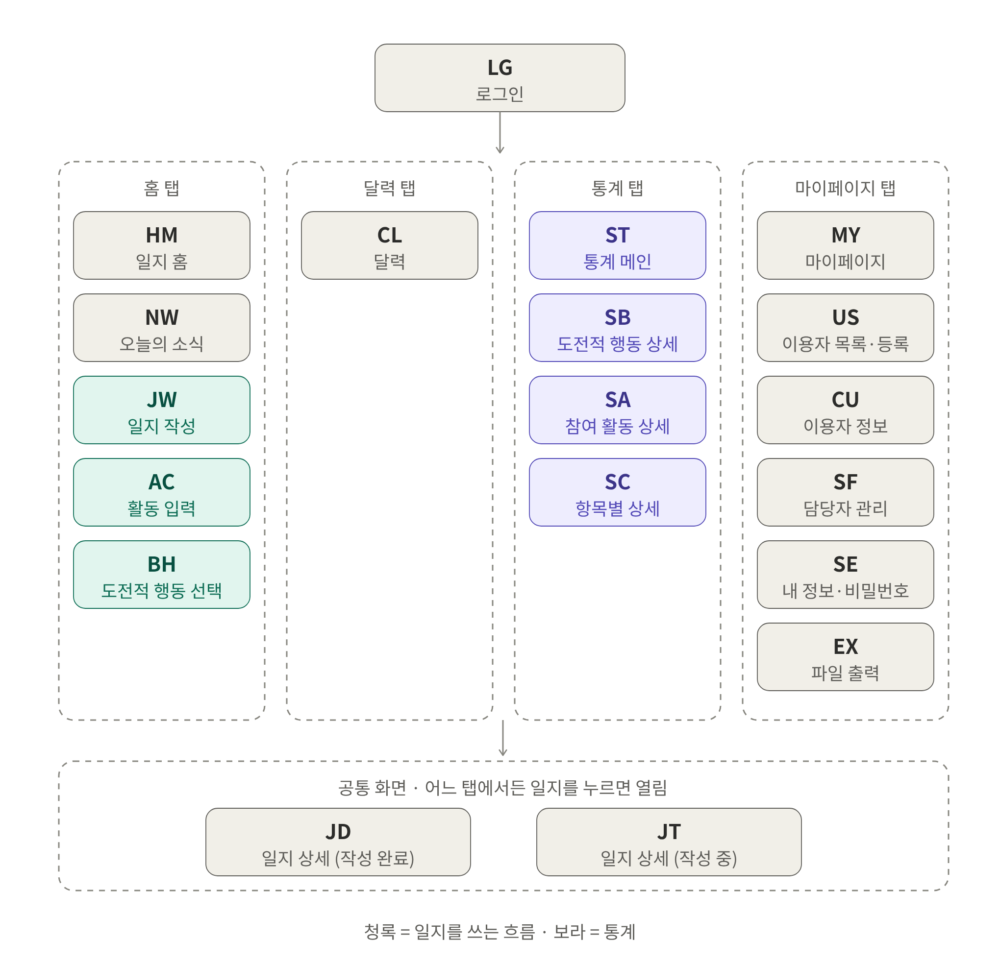
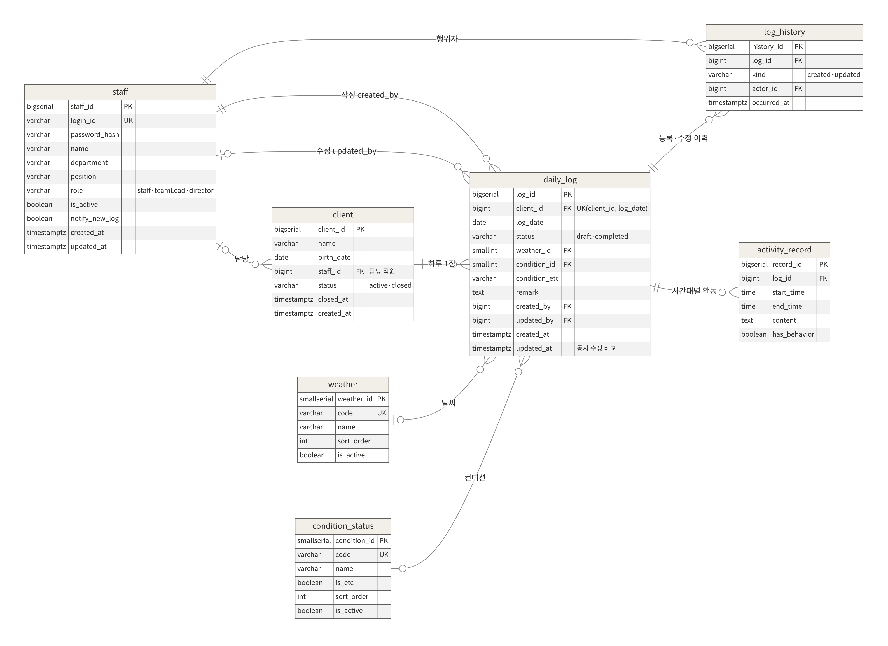
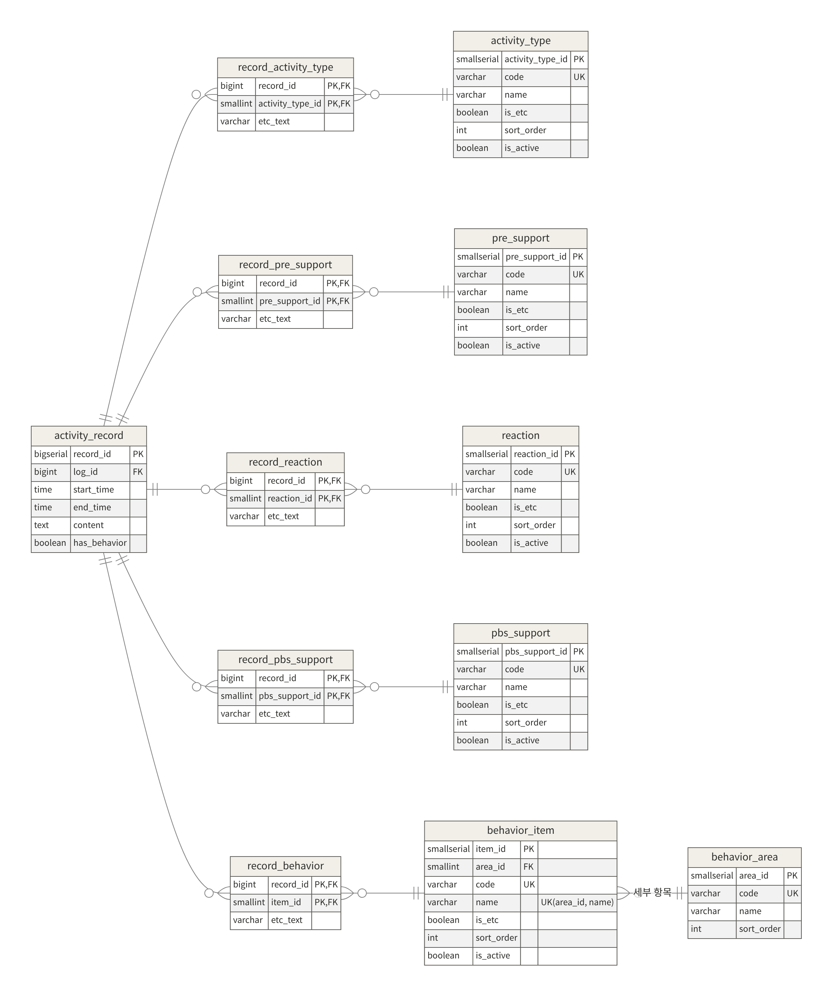

# welfare-be
돌봄 일지 작성·인수인계 API

---

# 원광복지관 일지 관리 앱 — 백엔드

프론트엔드 프로토타입([welfare-fe](https://github.com/seoil-welfare/welfare-fe))이 mock 모드로 흉내 내고 있는 서버를 **실제로 만드는 저장소**입니다.
지금은 **뼈대 단계**입니다. 서버가 켜지고 DB 테이블이 자동으로 만들어지는 것까지 되어 있고, 기능 API는 각자 브랜치에서 개발합니다.

> **개발과 시범 운영은 가상 데이터로만 진행합니다.**
> 복지관 답변지 등에 있는 실제 이용자 이름·생년월일은 개발 DB, 테스트 데이터, 커밋, 문서 어디에도 넣지 않습니다.
> DB 접속 정보(주소·아이디·비밀번호)는 코드나 git에 올리지 않고 환경변수로만 다룹니다.
> 안드로이드 앱과 웹은 DB에 직접 붙지 않고 반드시 이 API 서버를 거칩니다.

---

## 1. 실행 방법 (내 컴퓨터, Windows)

### 사전 준비

| 프로그램 | 버전 | 비고 |
|---|---|---|
| JDK | 21 | IntelliJ에서 프로젝트를 열 때 받아도 됩니다 |
| PostgreSQL | 18 | [postgresql.org/download/windows](https://www.postgresql.org/download/windows/) 설치 프로그램. 설치 중 정하는 `postgres` 비밀번호를 기억해 두세요. 포트는 기본값 `5432` |
| IntelliJ IDEA | Community 이상 | VS Code도 가능 |

### DB 만들기 (처음 한 번만)

시작 메뉴에서 **SQL Shell (psql)** 을 열고, 물어보는 항목은 엔터로 넘긴 뒤 `postgres` 비밀번호를 입력합니다.

```sql
CREATE USER welfare WITH PASSWORD '내가_정한_비밀번호';
CREATE DATABASE welfare OWNER welfare;
```

테이블은 만들 필요 없습니다. 서버를 처음 켤 때 Flyway가 `src/main/resources/db/migration`의 SQL로 자동으로 만듭니다.

### 비밀번호 파일 만들기

```powershell
copy .env.example .env      # 복사한 뒤 .env를 열어 DB_PASSWORD에 위 비밀번호를 적기
```

`.env`는 `.gitignore`에 들어 있어서 GitHub에 올라가지 않습니다. **비밀번호를 코드나 application.yml에 직접 쓰지 마세요.**

### 서버 실행

IntelliJ에서 `welfare-be` 폴더를 열고(Gradle 불러오기가 끝날 때까지 기다림) `WelfareApplication`의 ▶ 버튼을 누릅니다. 또는:

```powershell
.\gradlew.bat bootRun       # 서버: http://localhost:8080
```

브라우저에서 <http://localhost:8080/api/health> 를 열어 아래처럼 나오면 성공입니다.

```json
{ "status": "ok", "db": "PostgreSQL 18...", "tables": 19, "behaviorItems": 31, "staff": 5 }
```

| 값 | 뜻 |
|---|---|
| `tables: 19` | 테이블 18개 + Flyway 기록표 1개 |
| `behaviorItems: 31` | 도전적 행동 세부 항목 (타해 10 · 자해 11 · 파괴 9 · 기타 1) |
| `staff: 5` | 개발용 가상 직원 (`demo.staff1` 등, 비밀번호 `demo1234`) |

### 가상 데이터

`local` 프로필(기본값)로 실행하면 `src/main/resources/db/dev`의 가상 직원 5명·이용자 4명이 함께 들어갑니다. 프론트 mock과 같은 이름입니다. 운영 서버는 이 폴더를 읽지 않습니다.

### DB를 처음부터 다시 만들고 싶을 때

SQL Shell (psql)에서 `postgres`로 접속해서:

```sql
DROP DATABASE welfare;
CREATE DATABASE welfare OWNER welfare;
```

서버를 다시 켜면 테이블과 가상 데이터가 새로 들어갑니다.

> 서버 로그에 `PostgreSQL 18 is newer than this version of Flyway` 경고가 보여도 정상입니다. 경고일 뿐 테이블은 만들어집니다.

> 이미 실행된 `V1__init.sql`, `V2__dev_seed.sql`은 **고치지 마세요.** Flyway가 내용이 바뀐 걸 알아채고 서버를 멈춥니다.
> 테이블을 바꿀 땐 `V3__설명.sql`처럼 새 파일을 추가합니다.

### 프론트와 붙이기

welfare-fe 폴더의 `.env.local`:

```
VITE_API_MODE=http
VITE_API_PROXY_TARGET=http://localhost:8080
```

백엔드 서버와 프론트(`npm run dev`)를 둘 다 켜 둔 상태에서 <http://localhost:5173> 을 엽니다.

### 폴더 구조

```
welfare-be/
  build.gradle                Spring Boot 3.5 · Java 21 · 라이브러리 목록
  .env.example                DB 접속 정보 견본 (.env로 복사해서 사용)
  src/main/java/kr/seoil/welfare/
    WelfareApplication.java   서버 시작점
    common/HealthController   GET /api/health
    (diary/, auth/, stats/ … 기능별 패키지를 여기에 추가)
  src/main/resources/
    application.yml           공통 설정 (DB 주소는 환경변수에서)
    application-local.yml     내 컴퓨터용 설정 (가상 데이터 포함)
    db/migration/V1__init.sql 테이블 18개 + 선택 항목 목록
    db/dev/V2__dev_seed.sql   개발용 가상 직원·이용자
  docs/                       기능명세서, ERD, 스키마
```

---

## 2. 브랜치 규칙

`main`은 **항상 실행되는 상태**로 둡니다. main에 직접 올리지 않고, 기능마다 브랜치를 만들어 작업한 뒤 PR로 합칩니다.

| 브랜치 | 담당 | 내용 |
|---|---|---|
| `feature/diary` | 재웅 | 일지 작성·조회 (`/api/diaries`) |
| `feature/stats` | 재웅 | 통계 |
| `feature/login` | 지민 | 로그인·세션 (`/api/auth`) |
| `feature/notification` | 지민 | 알림 |
| `feature/report` | 희정 | 보고서·파일 출력 |
| `feature/calendar`, `feature/record` | 창건 | 달력·기록 |

1. 최신 main에서 브랜치를 만든다
2. 내 브랜치에서 개발 → 로컬에서 서버 켜고 확인 → 커밋
3. GitHub에 올리고 PR을 만든다 (설명에 무엇을 했는지, 어떻게 확인했는지)
4. 팀원 1명이 확인하면 Merge

**로그인 전까지의 약속:** 로그인(`feature/login`)이 합쳐지기 전에는, 다른 기능은 "가상 직원 1번(`demo.staff1`)이 로그인했다"고 가정하고 개발합니다. 로그인이 생기면 세션에 저장된 `staffId`를 쓰도록 그 부분만 바꿉니다.

---

## 3. 문서

| 문서 | 내용 |
|---|---|
| [`docs/functional-spec.md`](docs/functional-spec.md) | **기능명세서 v0.3** — 화면 19개, 기능 110개, API·에러 코드·운영 정책 전체 |
| [`docs/schema_v0.3.sql`](docs/schema_v0.3.sql) | PostgreSQL 테이블 18개 생성 SQL + 선택 항목 기본 데이터 + 통계 쿼리 예시 |
| [`docs/images/`](docs/images) | 앱 전체 지도, ERD 2장 |

이 README는 백엔드를 만들 때 바로 필요한 부분만 요약한 것입니다. 기능 하나하나의 화면 동작과 서버 처리는 기능명세서 3장을 보세요.

---

## 4. 기술 스택 (안)

팀 확정 전 추천안입니다.

| 구분 | 선택 | 이유 |
|---|---|---|
| 언어·프레임워크 | Java · Spring Boot (Spring Web, Spring Data JPA, Spring Security 세션) | 수업에서 Java를 쓰고, 쿠키 세션 로그인을 기본 기능으로 지원 |
| DB | PostgreSQL 18 | 통계용 집계·윈도 함수, 라이선스 부담 없음 |
| DB 변경 관리 | Flyway | `docs/schema_v0.3.sql`을 첫 마이그레이션(V1)으로 사용 |
| 서버 | AWS EC2 (서울 리전) | |
| DB 서버 | AWS RDS PostgreSQL (외부 접속 차단) | 백업·패치를 AWS가 관리 |
| 프론트 배포 | S3 + CloudFront | 한 주소에서 화면과 `/api`를 같이 제공 → HTTPS 무료, 쿠키 문제 없음 |

```
[Browser / Android]
      |
      v  https
[CloudFront] --- /*     ---> [S3]  frontend build
             \-- /api/* ---> [EC2] Spring Boot ---> [RDS] PostgreSQL
```

AWS 비용 주의: 예산 알림 설정, NAT 게이트웨이 만들지 않기, 공인 IPv4 요금 확인, 계정 주인(누구 카드인지) 먼저 정하기.

---

## 5. 화면과 기능 현황

프론트(welfare-fe main, 2026. 10. 12.) 기준입니다. **구현**은 프론트 mock에서 동작한다는 뜻이고, 백엔드가 같은 규칙을 지키면 그대로 연결됩니다.

| 화면 ID | 화면 | 기능 수 | 구현 | 부분 구현 | 미구현 | 시연용 |
|---|---|---|---|---|---|---|
| LG | 로그인 | 4 | 2 | 1 | 1 | 0 |
| HM | 일지 홈 | 4 | 4 | 0 | 0 | 0 |
| NW | 오늘의 소식 | 3 | 3 | 0 | 0 | 0 |
| JW | 일지 작성 | 11 | 10 | 0 | 0 | 1 |
| AC | 활동 입력/수정 | 11 | 11 | 0 | 0 | 0 |
| BH | 도전적 행동 선택 | 4 | 2 | 1 | 1 | 0 |
| CL | 달력 | 3 | 3 | 0 | 0 | 0 |
| ST | 통계 메인 | 11 | 11 | 0 | 0 | 0 |
| SB | 도전적 행동 상세 통계 | 7 | 7 | 0 | 0 | 0 |
| SA | 참여 활동 상세 통계 | 6 | 6 | 0 | 0 | 0 |
| SC | 항목별 상세 통계 | 1 | 0 | 0 | 0 | 1 |
| JD | 일지 상세 (작성 완료) | 10 | 9 | 0 | 1 | 0 |
| JT | 일지 상세 (작성 중) | 8 | 7 | 0 | 0 | 1 |
| MY | 마이페이지 | 10 | 9 | 0 | 0 | 1 |
| US | 이용자 목록·등록 | 2 | 2 | 0 | 0 | 0 |
| CU | 이용자 정보 | 8 | 8 | 0 | 0 | 0 |
| SF | 담당자 목록·계정 추가 | 3 | 2 | 0 | 1 | 0 |
| SE | 내 정보·비밀번호 변경 | 2 | 2 | 0 | 0 | 0 |
| EX | 파일 출력 | 2 | 1 | 0 | 1 | 0 |
| **합계** | | **110** | **99** | **2** | **5** | **4** |



---

## 6. API

### 공통 약속

- 모든 경로는 `/api` 아래, JSON(UTF-8)입니다.
- 날짜는 `YYYY-MM-DD`, 시각은 `2026-10-13T09:00:00+09:00` 형식, 활동 시간은 `HH:mm`입니다.
- 로그인은 **쿠키 세션**입니다. 어느 요청이든 401이면 프론트가 로그인 화면으로 보냅니다.
- 오류는 항상 같은 모양으로 돌려줍니다. `message`는 화면에 그대로 보이므로 한국어 문장으로 씁니다.

```json
{ "message": "이미 같은 날짜의 일지가 있어요.", "code": "DIARY_ALREADY_EXISTS", "details": { "existingDiaryId": "42" } }
```

- 권한은 **전부 서버에서 검사**합니다. 화면에서 메뉴를 숨기는 건 보안이 아닙니다.

### 엔드포인트

프론트 `src/api/http/httpApi.ts`에 이미 구현된 호출입니다.

| 메서드 | 경로 | 하는 일 |
|---|---|---|
| `POST` | `/auth/login` | 로그인 `{ loginId, password, autoLogin }` |
| `POST` | `/auth/logout` | 로그아웃 |
| `GET` | `/auth/me` | 내 정보 (로그인 안 됐으면 401) |
| `PUT` | `/auth/password` | 비밀번호 변경 |
| `GET` | `/diaries?userId=&from=&to=&status=` | 일지 목록 (날짜 → 이용자 순) |
| `GET` | `/diaries/:id` | 일지 1건 (활동 포함) |
| `POST` | `/diaries` | 새 일지 저장 |
| `PUT` | `/diaries/:id` | 일지 수정 (활동은 통째로 교체) |
| `GET` | `/news?since=` | 오늘의 소식 (등록·수정 이력, 최신순) |
| `GET` | `/service-users` | 이용자 목록 (종결 포함) |
| `POST` | `/service-users` | 이용자 등록 |
| `PUT` | `/service-users/:id` | 이용자 정보 수정 |
| `POST` | `/service-users/:id/close` | 이용 종결 (삭제 아님) |
| `GET` | `/staff` | 직원 목록 |
| `POST` | `/staff` | 직원 계정 추가 |

**제안 API**(프론트 수정 필요): `GET /categories`(선택 항목 코드 목록), `GET /stats/summary` · `/stats/behaviors` · `/stats/activities` · `/stats/categories/:category`(서버 통계 집계), `POST /staff/:id/deactivate` · `/activate`(직원 사용 중지). 요청·응답은 기능명세서 5장에 있습니다.

### 에러 코드

| HTTP | code | 언제 |
|---|---|---|
| 400 | `VALIDATION_ERROR` | 필수값 누락, 형식 오류 |
| 400 | `INVALID_STATUS_TRANSITION` | 작성 완료 일지를 작성 중으로 저장 |
| 400 | `CURRENT_PASSWORD_MISMATCH` | 현재 비밀번호 틀림 |
| 400 | `PASSWORD_POLICY` | 새 비밀번호 규칙 위반 |
| 401 | `UNAUTHENTICATED` | 세션 없음·만료 |
| 401 | `INVALID_CREDENTIALS` | 아이디·비밀번호 불일치 |
| 403 | `ACCOUNT_DISABLED` | 사용 중지된 계정 |
| 403 | `FORBIDDEN` | 권한 없음 |
| 404 | `NOT_FOUND` | 일지·이용자·직원 없음 |
| 409 | `DIARY_ALREADY_EXISTS` | 같은 이용자·같은 날짜 일지가 이미 있음 |
| 409 | `DIARY_UPDATED_BY_OTHER` | 다른 사람이 먼저 수정함 |
| 409 | `DUPLICATE_LOGIN_ID` | 아이디 중복 |
| 500 | `INTERNAL_ERROR` | 서버 내부 오류 |

---

## 7. 서버가 지켜야 할 규칙

프론트 `src/api/mock/mockApi.ts`가 흉내 내고 있는 규칙을 실제 서버에서 그대로 지켜야 합니다.

- **이용자 1명당 하루 1건.** 같은 이용자·같은 날짜로 새 일지를 저장하면 `409 DIARY_ALREADY_EXISTS`와 기존 일지 id를 돌려줍니다. DB `UNIQUE(client_id, log_date)`가 최종으로 막습니다.
- **상태는 한 방향.** 작성 중(`draft`) → 작성 완료(`completed`)만 가능합니다. 완료 일지는 완료 상태 그대로 수정하고, 작성 중으로 되돌리면 `400 INVALID_STATUS_TRANSITION`입니다.

  | 저장 전 | 요청 | 결과 | 소식 이력 |
  |---|---|---|---|
  | 없음 | `draft` | 허용 | 없음 |
  | 없음 / `draft` | `completed` | 허용 | 등록 |
  | `draft` | `draft` | 허용 | 없음 |
  | `completed` | `completed` | 허용 | 수정 |
  | `completed` | `draft` | **거부** | — |

- **작성자는 서버가 정합니다.** 처음 저장한 로그인 직원이 작성자이고, 수정해도 바뀌지 않습니다. 수정자·수정 시각은 따로 기록합니다.
- **동시 수정 감지(제안).** `PUT`에 불러올 때 받은 `updatedAt`을 담아 보내고, DB 값과 다르면 저장하지 않고 `409 DIARY_UPDATED_BY_OTHER`를 돌려줍니다.
- **활동은 통째로 교체.** 일지 저장 때 기존 활동을 지우고 받은 배열로 다시 넣습니다(하위 선택 항목은 `ON DELETE CASCADE`).
- **통계는 작성 완료 일지만** 셉니다. 단위는 `건`, 도전적 행동은 세부 항목 선택 건수, 발생 일수는 날짜 기준입니다.
- **삭제하지 않습니다.** 이용자는 종결(`closed`), 직원은 사용 중지(`is_active = false`)로 처리해 과거 일지의 이름이 남도록 합니다.

---

## 8. DB 구조

PostgreSQL 테이블 18개입니다. 실제 PostgreSQL에서 생성과 제약조건(하루 1건, 종료 > 시작, 종결 상태 등)을 시험해 통과했습니다.

| 묶음 | 테이블 | 역할 |
|---|---|---|
| 사람 | `staff`, `client` | 직원 계정, 이용자 |
| 기록 | `daily_log`, `activity_record`, `log_history` | 일지 → 시간대별 활동 → 등록·수정 이력(오늘의 소식) |
| 선택 항목 목록 | `weather`, `condition_status`, `activity_type`, `pre_support`, `reaction`, `pbs_support`, `behavior_area`, `behavior_item` | 화면의 체크 항목. 한글 이름 대신 `code`로 저장 |
| 다중 선택 연결 | `record_activity_type`, `record_pre_support`, `record_reaction`, `record_pbs_support`, `record_behavior` | 활동 1건에서 체크한 항목들. `기타`는 `etc_text`에 저장 |

### ① 사람 · 일지 · 이력



### ② 활동 기록 — 선택 항목 연결



---

## 9. 아직 정해지지 않은 것

| 항목 | 현재 프론트 | 제안 · 확인할 곳 |
|---|---|---|
| 도전적 행동 세부 목록 | 예시 항목 A~D | 복지관 답변 목록(타해 10·자해 11·파괴 9)으로 교체 — `schema_v0.3.sql`에 있음 |
| 생년월일 | `YYYY-MM-DD` | 화면은 6자리 입력, DB는 날짜로 저장 |
| 활동 시간 | 0~23시, 10분 단위 | 복지관 양식대로 10~17시, 30분 단위 |
| 선택 항목 값 | 한글 라벨 저장 | 코드 저장 + `GET /categories` |
| 상단 `임시저장` | 서버에 저장 안 함 | 서버에 `draft`로 저장, 첫 저장 후엔 `PUT` |
| 권한 | 팀장·국장만 담당자 관리 | 복지관 답변: 전원 동일 권한 → **회의 확인** |
| 다른 직원의 작성 중 일지 | 읽기만 | **회의 확인** |
| 자동 로그인 유지 기간 | 값만 전송 | **회의 확인** |
| 파일 출력 | 미연동 | 엑셀부터, PDF·HWPX는 양식 확정 후 |

전체 목록은 기능명세서 6장(프론트와 다른 부분)과 9장(협의 사항 B-1~B-13)에 있습니다.

---

## 10. 다음 할 일

1. ~~Spring Boot 프로젝트 생성, Flyway에 `V1__init.sql` 등록~~ ✅ 뼈대 완료
2. 로그인·세션 (`/auth/*`)
3. 일지 저장·조회 (`/diaries`) — 하루 1건, 상태 전이, 이력 기록
4. 이용자·직원 (`/service-users`, `/staff`)
5. 프론트 `.env.local`에 `VITE_API_MODE=http`로 붙여서 확인
6. AWS 배포 (EC2 + RDS + S3/CloudFront)
