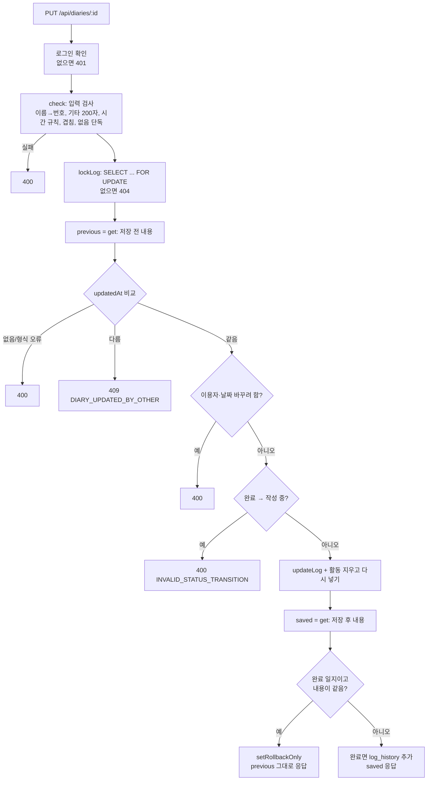

# PR #3 변경 설명: 이용자·직원 API, 일지 저장 규칙, 동시 수정, 통계 집계

PR [#3](https://github.com/seoil-welfare/welfare-be/pull/3) (`feature/admin-api-diary-fixes`)에서 바꾼 백엔드 코드를 설명하는 문서입니다.
무엇을 바꿨는지와 함께, 요청 하나가 어떤 순서로 처리되는지, 왜 그렇게 정했는지를 적었습니다.

같은 때 올라간 프론트 PR([welfare-fe #10](https://github.com/seoil-welfare/welfare-fe/pull/10))과 함께 배포해야 합니다.
일지 수정(PUT)에 `updatedAt`이 필수가 되었기 때문입니다(6장).

## 목차

1. [이용자 등록·수정·종결 API](#1-이용자-등록수정종결-api)
2. [직원 계정 추가 API](#2-직원-계정-추가-api)
3. ['기타' 직접 입력 200자 검사](#3-기타-직접-입력-200자-검사)
4. [활동 시간 규칙 검사](#4-활동-시간-규칙-검사)
5. [같은 내용 재저장 무시](#5-같은-내용-재저장-무시)
6. [동시 수정 충돌 409](#6-동시-수정-충돌-409)
7. [통계 API 상세 집계](#7-통계-api-상세-집계)
8. [일지 수정(PUT) 전체 처리 순서](#8-일지-수정put-전체-처리-순서)
9. [오류 응답 정리](#9-오류-응답-정리)
10. [직접 확인해 보는 방법](#10-직접-확인해-보는-방법)
11. [아직 정하지 않은 것](#11-아직-정하지-않은-것)

### 바뀐 파일

| 파일 | 상태 | 관련 장 |
|---|---|---|
| `client/ServiceUserController.java` | 수정 | 1 |
| `client/ServiceUserService.java` | 새 파일 | 1 |
| `client/ServiceUserInput.java` | 새 파일 | 1 |
| `staff/StaffController.java` | 수정 | 2 |
| `staff/CreateStaffRequest.java` | 새 파일 | 2 |
| `staff/CreatedStaffResponse.java` | 새 파일 | 2 |
| `auth/AuthService.java` | 수정 | 2 |
| `diary/DiaryService.java` | 수정 | 3, 4, 5, 6 |
| `diary/dto/SaveDiaryRequest.java` | 수정 | 6 |
| `diary/Catalog.java` | 수정 | 7 |
| `stats/StatsController.java` | 주석만 수정 | 7 |
| `stats/StatsRepository.java` | 수정 | 7 |
| `stats/StatsService.java` | 수정 | 7 |
| `stats/StatsSummaryResponse.java` | 수정 | 7 |
| `docs/functional-spec.md` | 수정 | 명세 4.4·4.6·5.2 반영 |

경로 앞의 `src/main/java/kr/seoil/welfare/`는 생략했습니다. DB 스키마와 마이그레이션은 바뀌지 않았습니다.

---

## 1. 이용자 등록·수정·종결 API

### 왜 바꿨나

프론트 이용자 관리 화면에는 등록·수정·이용 종결 버튼이 있었습니다. 하지만 서버에는 목록 조회(`GET`)만 있어서 버튼을 누르면 404가 났습니다.

### API

```
GET  /api/service-users              → ServiceUserDto[]          (종결된 이용자 포함)
POST /api/service-users              → 201 ServiceUserDto
PUT  /api/service-users/{id}         → ServiceUserDto / 404
POST /api/service-users/{id}/close   → ServiceUserDto (status: closed)
```

요청 본문은 `ServiceUserInput`이고, 프론트 `ServiceUserInput` 타입과 모양이 같습니다.

```json
{ "name": "김가상", "birthDate": "1999-12-07", "assignedStaffId": "1" }
```

응답(`ServiceUserDto`)은 아래 모양입니다.

```json
{ "id": "1", "name": "김가상", "birthDate": "1999-12-07", "assignedStaffId": "1", "status": "active" }
```

담당 직원이 없으면 `assignedStaffId`는 빈 문자열 `""`입니다.

### 코드 구조

```
ServiceUserController   로그인 확인(SessionStaff.require)만 하고 Service로 넘김
  └─ ServiceUserService  입력 검사 + SQL (JdbcTemplate)
```

이 기능은 SQL이 짧아서 Repository를 따로 만들지 않았습니다. 기존 `GET` 목록 SQL도 컨트롤러에서 이 Service로 옮겼습니다.

### 입력 검사 (`ServiceUserService.check`)

등록과 수정이 같은 검사를 씁니다. 틀리면 모두 400 `VALIDATION_ERROR`입니다.

| 항목 | 규칙 | 오류 문구 |
|---|---|---|
| 본문 | 없으면 안 됨 | 이용자 정보를 입력해 주세요. |
| name | 앞뒤 공백을 지운 뒤 비어 있으면 안 됨 | 이름을 입력해 주세요. |
| name | 50자 이하 (DB `VARCHAR(50)`) | 이름이 너무 길어요. |
| birthDate | `YYYY-MM-DD`로 읽을 수 있어야 함 (`LocalDate.parse`) | 생년월일을 YYYY-MM-DD 형식으로 입력해 주세요. |
| birthDate | 한국 시간 기준 오늘보다 뒤면 안 됨 | 생년월일이 오늘보다 뒤예요. |
| assignedStaffId | 비어 있으면 '담당 미지정'(`NULL`로 저장) | – |
| assignedStaffId | 숫자여야 함 | 담당 직원 번호가 올바르지 않아요. |
| assignedStaffId | 사용 중인(`is_active`) 직원이어야 함 | 담당 직원으로 고를 수 없는 직원이에요. |

`2000-13-40`처럼 형식은 맞지만 없는 날짜도 `LocalDate.parse`가 거절하므로 400입니다.

### 처리 흐름

**등록 (`create`)**
1. `check()`로 검사합니다.
2. `INSERT INTO client (name, birth_date, staff_id) ... RETURNING client_id`를 실행합니다. `status`는 DB 기본값 `active`가 들어갑니다.
3. 방금 만든 줄을 다시 읽어 응답합니다. HTTP 상태는 201입니다.

**수정 (`update`)**
1. 주소의 id를 숫자로 바꿉니다. 숫자가 아니면 그런 이용자는 없는 것이므로 404입니다(400이 아님).
2. `check()`로 검사합니다.
3. `UPDATE client SET name, birth_date, staff_id WHERE client_id = ?`를 실행합니다. 바뀐 줄이 0개면 404입니다.
4. 종결된 이용자도 정보 수정은 됩니다. `status`는 수정 대상이 아닙니다.

**종결 (`close`)**
1. `UPDATE client SET status = 'closed', closed_at = now() WHERE client_id = ? AND status = 'active'`
2. 다시 읽어 응답합니다. 없는 id면 404입니다.

### 왜 이렇게 정했나

- **종결은 삭제가 아님:** 이용자 줄을 지우면 그 사람의 과거 일지(`daily_log.client_id`)와 통계가 깨집니다. 그래서 상태만 바꿉니다. 목록 조회에 종결 이용자를 포함하는 것도, 과거 일지 화면에 이름을 보여 줘야 하기 때문입니다.
- **종결을 두 번 눌러도 안전함:** `AND status = 'active'` 조건이 있어서 이미 종결된 이용자는 UPDATE 대상이 아닙니다. 그래서 처음 종결한 시각(`closed_at`)이 덮어써지지 않고, 응답은 똑같이 `closed`입니다.
- **스키마 CHECK와 맞음:** `client` 테이블에는 `(status = 'closed') = (closed_at IS NOT NULL)` 제약이 있습니다. 종결할 때 두 칸을 함께 바꿔야 이 제약에 걸리지 않습니다.
- **권한:** 명세 8.1 기준안대로 로그인한 직원이면 누구나 할 수 있습니다.

---

## 2. 직원 계정 추가 API

### 왜 바꿨나

담당자 관리 화면의 '계정 추가'에 연결된 서버 API가 없었습니다. 회원가입(`/api/auth/signup`)은 아무나 부를 수 있어서 항상 `staff` 권한으로만 만듭니다. 그래서 팀장·국장 계정을 만들 방법이 DB 직접 수정뿐이었습니다.

### API

```
POST /api/staff
요청: { "name": "새직원", "loginId": "new.staff", "department": "", "position": "사회복지사", "role": "staff" }
응답: 201 { "id", "name", "department", "position", "role", "loginId", "temporaryPassword": "a8Kp3mQx7ZtR" }
```

- `CreateStaffRequest`는 프론트 `StaffInput`과 같은 모양입니다.
- `position`은 받지만 쓰지 않습니다. 직위는 `role`에서 정해집니다(명세 SF-02). `staff`는 사회복지사, `teamLead`는 팀장, `director`는 국장입니다.
- `department`가 비어 있으면 '주간활동지원팀'이 들어갑니다.
- `role`이 비어 있으면 `staff`로 봅니다.

### 권한 규칙 (`AuthService.createStaff`)

| 요청한 사람 | 만들려는 역할 | 결과 |
|---|---|---|
| staff | 무엇이든 | 403 `FORBIDDEN` "계정 추가는 팀장·국장만 할 수 있어요." |
| teamLead | staff, teamLead | 201 |
| teamLead | director | 403 `FORBIDDEN` "국장 계정은 국장만 추가할 수 있어요." |
| director | 무엇이든 | 201 |
| 사용 중지된 계정 | – | 403 `ACCOUNT_DISABLED` |

요청한 사람의 역할은 세션의 직원 번호로 `me(actorId)`를 불러 DB에서 다시 읽습니다. 그래서 로그인한 뒤에 사용 중지되었거나 역할이 바뀐 경우에도 지금 상태로 판단합니다.
팀장이 국장 계정을 만들 수 없게 한 이유는, 자기보다 높은 권한을 만들어 권한이 올라가는 일을 막기 위해서입니다.

### 처리 흐름

1. `me(actorId)`로 요청한 사람의 역할을 읽습니다. 계정이 사용 중지 상태면 여기서 403입니다.
2. 역할이 `teamLead`나 `director`가 아니면 403입니다.
3. 본문이 없으면 400입니다.
4. `role`을 확인합니다. `staff`, `teamLead`, `director` 중 하나가 아니면 400입니다.
5. 국장 계정을 국장이 아닌 사람이 만들려고 하면 403입니다.
6. `checkNewAccount()`로 아이디·이름·부서를 검사하고 아이디 중복을 확인합니다(아래 '공통 검사').
7. 임시 비밀번호를 만들고, BCrypt 해시로 바꿔 `INSERT`합니다(`insertAccount`).
8. 만든 직원 정보에 임시 비밀번호를 붙여 응답합니다(`CreatedStaffResponse.of`).

### 공통 검사 (회원가입과 같이 씀)

이번에 회원가입(`signup`)과 계정 추가가 같은 코드를 쓰도록 두 메서드로 나눴습니다. 회원가입의 동작은 바뀌지 않았습니다.

- **`checkNewAccount(loginId, name, department)`**
  - 아이디는 앞뒤 공백을 지우고 소문자로 바꿉니다. 영문 소문자·숫자·`.`·`_`·`-`만 쓸 수 있고 4~50자입니다.
  - 이름은 필수이고 50자 이하입니다.
  - 부서는 비어 있으면 기본값을 넣고, 50자 이하입니다.
  - 아이디가 이미 있으면 409 `DUPLICATE_LOGIN_ID`입니다.
- **`insertAccount(account, password, role)`**
  - 비밀번호를 BCrypt로 해시해 `INSERT`합니다. 직위는 `positionOf(role)`로 정합니다.
  - 두 사람이 같은 아이디로 동시에 눌러 위 중복 확인을 둘 다 통과하는 경우가 있습니다. 이때는 DB UNIQUE 제약이 막아 `DuplicateKeyException`이 나는데, 이것도 `DUPLICATE_LOGIN_ID`로 바꿔 던집니다.
  - 바꾸지 않으면 공통 처리기(`GlobalExceptionHandler`)가 이 예외를 일지 중복(`DIARY_ALREADY_EXISTS`)으로 응답합니다.

### 임시 비밀번호

```java
TEMP_PASSWORD_CHARS = "abcdefghijkmnpqrstuvwxyzABCDEFGHJKLMNPQRSTUVWXYZ23456789";
TEMP_PASSWORD_LENGTH = 12;
RANDOM = new SecureRandom();
```

- **글자:** 헷갈리는 글자 `0 O 1 l I`는 뺐습니다. 종이나 화면을 보고 옮겨 적을 때 틀리지 않게 하려는 것입니다.
- **난수:** `java.util.Random`이 아니라 `SecureRandom`을 씁니다. 비밀번호는 예측할 수 없어야 하기 때문입니다.
- **저장:** DB에는 해시만 저장합니다. 원문은 이 응답에 한 번만 담기므로 나중에 다시 볼 수 없습니다.
- **비밀번호 규칙:** 12자에 영문·숫자가 섞이도록 만들어, 비밀번호 규칙(`PasswordPolicy`: 8자 이상, 영문+숫자)을 대부분 만족합니다. 아주 드물게 숫자나 영문이 빠질 수 있지만, 서버가 만든 값이라 규칙 검사를 거치지 않으므로 로그인에는 문제가 없습니다.
- **화면 표시:** 초기 비밀번호를 어떻게 전달할지는 아직 정하지 않았습니다(11장). 그래서 지금 프론트는 이 값을 화면에 보여 주지 않습니다.

---

## 3. '기타' 직접 입력 200자 검사

### 왜 바꿨나

'기타'를 고르고 직접 쓴 내용은 DB의 `etc_text VARCHAR(200)`, `condition_etc VARCHAR(200)` 칸에 들어갑니다. 서버에 길이 검사가 없어서 200자를 넘기면 DB가 거절했고, 그 예외가 500(서버 오류)으로 나갔습니다.

### 바꾼 것

`DiaryService.etcText(String)`을 새로 만들었습니다.

```java
private static String etcText(String s) {
    String text = trimToNull(s);                 // 앞뒤 공백 제거, 비면 null
    if (text != null && text.length() > ETC_MAX) {   // ETC_MAX = 200
        throw ApiException.badRequest("'기타' 직접 입력은 200자까지 쓸 수 있어요.");
    }
    return text;
}
```

원래 '기타' 직접 입력에는 `trimToNull`을 쓰고 있었는데, 그 자리를 모두 `etcText`로 바꿨습니다.

| 위치 | 대상 |
|---|---|
| `check()` | 컨디션 '기타' (`conditionOther`) |
| `toPicks()` | 참여 활동·사전 지원·이용자 반응·긍정행동지원의 '기타' |
| `toBehaviorPicks()` | 상위 '기타' 도전적 행동, 세부 '기타'(`oh-other` 등) |

- 200자 기준은 공백을 지운 뒤의 길이입니다.
- 일지 전체가 한 트랜잭션이라 검사에 걸리면 아무것도 저장되지 않습니다.

---

## 4. 활동 시간 규칙 검사

### 왜 바꿨나

프론트는 활동 시간을 10:00~17:00 사이 30분 칸으로만 고르게 합니다. 하지만 서버는 '종료가 시작보다 늦은지'만 봤습니다. 그래서 `09:15`나 겹치는 시간이 API로 직접 들어오면 그대로 저장되었습니다. 이런 데이터가 생기면 통계와 출력에서 어긋납니다.

### 규칙

| 규칙 | 메서드 | 오류 문구 (모두 400) |
|---|---|---|
| 시각은 10:00 이상 17:00 이하 | `checkSlotTime` | 활동 시간은 10:00~17:00 사이에서 30분 단위로 골라 주세요. |
| 분이 0 또는 30, 초는 0 | `checkSlotTime` | (위와 같음) |
| 종료가 시작보다 늦어야 함 (기존 규칙) | `checkActivity` | 종료 시간은 시작 시간보다 늦어야 해요. |
| 같은 일지 안에서 시간이 겹치면 안 됨 | `checkNoOverlap` | 활동 시간이 다른 활동과 겹쳐요. |
| 작성 완료면 모든 활동에 시작·종료 시간이 있어야 함 | `checkActivity` | 활동 시간을 골라 주세요. |

상수는 `DiaryService` 위쪽에 있습니다.

```java
FIRST_TIME = 10:00, LAST_TIME = 17:00, SLOT_MINUTES = 30
```

### 겹침 검사 (`checkNoOverlap`)

1. 시작·종료 시간이 둘 다 있는 활동만 고릅니다. 작성 중 일지에는 시간이 빈 활동이 있을 수 있습니다.
2. 시작 시각 순으로 정렬합니다.
3. 바로 앞 활동의 종료보다 다음 활동의 시작이 이르면 겹친 것입니다.

```
10:00~10:30, 10:30~11:30   → 통과 (끝과 시작이 붙는 것은 겹침 아님)
10:00~11:00, 10:30~11:30   → 400
```

정렬한 뒤 이웃끼리만 비교하므로 활동이 n개면 O(n log n)입니다.

### 작성 중과 작성 완료의 차이

- **작성 중(`draft`):** 자동 임시저장으로 들어오므로, 시간을 아직 고르지 않은 활동이 있어도 저장합니다. DB도 V3 마이그레이션에서 시간 칸을 NULL 허용으로 바꿔 두었습니다.
- **작성 완료(`completed`):** 시간이 빠진 활동이 있으면 거절합니다.
- 범위·단위·겹침 검사는 시간이 들어 있는 활동이면 작성 중일 때도 적용합니다.

`check()`가 요청의 `status`를 보고 `completed` 값을 `checkActivity(a, completed)`에 넘깁니다.

### 기존 데이터

개발 DB의 가상 일지 380건을 이 규칙으로 확인했습니다. 범위 밖, 30분 단위 아님, 완료인데 시간 없음, 겹침이 모두 0건이었습니다. 기존 일지를 그대로 다시 저장해도 400이 나지 않습니다.

---

## 5. 같은 내용 재저장 무시

### 왜 바꿨나

작성 완료된 일지를 아무것도 바꾸지 않고 다시 저장해도, 저장할 때마다 다음 일이 생겼습니다.

- `log_history`에 '수정' 이력이 쌓여 홈의 오늘의 소식에 "수정" 줄이 늘어남
- `updated_by`(마지막 수정자)가 저장한 사람으로 바뀜
- `updated_at`이 바뀜

예를 들어 "이 활동만 수정" 화면에 들어갔다가 그냥 저장만 해도 수정한 것으로 기록되었습니다.

### 바꾼 것 (`DiaryService.update`)

```java
DiaryResponse previous = get(diaryId);          // 저장 전 내용 (잠근 뒤에 읽음)
... 일지·활동 저장 ...
DiaryResponse saved = get(String.valueOf(logId));   // 저장 후 내용
if (wasCompleted && sameContent(previous, saved)) {
    TransactionAspectSupport.currentTransactionStatus().setRollbackOnly();
    return previous;                            // 바뀐 게 없으면 저장 전 그대로 응답
}
```

`sameContent`는 다음을 비교합니다.
- `status`, `weather`, `condition`, `conditionOther`, `notes`
- 활동 목록 전체. 활동 id는 빼고 비교합니다(`withoutIds`).

활동 id를 빼는 이유: 저장할 때마다 활동을 지우고 다시 넣기 때문에 `record_id`가 매번 새로 붙습니다. id까지 비교하면 늘 '다르다'가 됩니다.

### 왜 저장한 뒤에 비교하나

요청 JSON과 DB 내용을 저장 전에 직접 비교하는 방법도 있습니다. 하지만 그러려면 요청을 '서버가 저장하는 모양'으로 바꾸는 코드를 한 벌 더 만들어야 합니다.
- 이름 → 번호 → 이름
- 중복 선택 제거
- 목록 순서 정렬
- 상위 '기타'의 세부 목록 비우기

이 변환이 두 군데에 있으면 언젠가 어긋납니다. 그래서 실제로 저장하고 `get()`으로 다시 읽은 결과끼리 비교합니다. 양쪽이 같은 조립 코드(`assemble`)를 거치므로 정확합니다.
바뀐 게 없으면 `setRollbackOnly()`로 트랜잭션 전체를 되돌립니다. 결과적으로 DB에는 아무 흔적도 남지 않습니다.

### 적용 범위

- **완료 일지:** `wasCompleted`가 참일 때만 적용합니다.
- **작성 중 일지:** 소식 이력이 원래 없고, 수정 시각이 바뀌어도 문제가 없어서 그대로 저장합니다.
- **작성 중 → 작성 완료:** `status`가 바뀌므로 '다름'으로 판단되어 '등록' 소식이 정상적으로 생깁니다.

---

## 6. 동시 수정 충돌 409

### 왜 바꿨나

두 사람이 같은 일지를 열고 고치면, 나중에 저장한 사람의 내용으로 전부 덮어써졌습니다. 먼저 저장한 사람의 기록은 아무 알림 없이 사라졌습니다(명세 4.6, B-3).

```
10:00  A가 일지를 엶 (updatedAt = T1)
10:01  B가 같은 일지를 엶 (updatedAt = T1)
10:05  A가 저장 → DB updatedAt = T2
10:06  B가 저장 → A의 수정이 사라짐   ← 이번에 막은 것
```

### 규칙

PUT 요청에 일지를 불러올 때 받은 `updatedAt`을 그대로 담아 보내야 합니다. 서버는 이 값을 DB의 `updated_at`과 비교합니다.

| 경우 | 결과 |
|---|---|
| 같음 | 저장하고 새 `updatedAt`을 응답 |
| 다름 (그사이 누가 저장함) | 저장하지 않고 409 `DIARY_UPDATED_BY_OTHER` |
| `updatedAt`이 없음 | 400 "일지를 다시 불러온 뒤 저장해 주세요." |
| 날짜 형식이 아님 | 400 "updatedAt 형식이 올바르지 않아요." |

409 응답은 아래 모양입니다.

```json
{
  "message": "다른 분이 먼저 수정했어요. 최신 내용을 다시 불러와 주세요.",
  "code": "DIARY_UPDATED_BY_OTHER",
  "details": {
    "updatedAt": "2026-10-30T14:56:38.751305+09:00",
    "lastEditorId": "4"
  }
}
```

`lastEditorId`는 작성 완료 후 수정한 직원이 있을 때만 들어갑니다. 작성 중 일지끼리 충돌하면 `updatedAt`만 있습니다.

### 코드

`SaveDiaryRequest`에 칸을 하나 추가했습니다.

```java
String updatedAt   // PUT일 때 필수. 불러올 때 받은 updatedAt 그대로
```

`POST`(새 일지)에서는 이 값을 보지 않습니다.

`DiaryService.checkNotUpdatedByOther`:

```java
same = OffsetDateTime.parse(requestUpdatedAt.trim()).toInstant()
        .equals(OffsetDateTime.parse(current.updatedAt()).toInstant());
```

### 설계 이유

- **문자열이 아니라 시각(Instant)으로 비교:**
  - 같은 시각이 `2026-10-30T14:56:38.849250+09:00`(한국 시간)이나 `2026-10-30T05:56:38.849250Z`(UTC)처럼 다르게 적힐 수 있습니다.
  - 문자열로 비교하면 같은 시각을 다르다고 판단하므로, 시각으로 바꿔 비교합니다.
- **마이크로초까지 비교:**
  - PostgreSQL `TIMESTAMPTZ`는 마이크로초(소수점 6자리)까지 저장하고, 응답(`iso()`)도 그 자리까지 그대로 보냅니다.
  - 그래서 같은 초 안에 연달아 저장해도 값이 다릅니다.
  - 프론트는 받은 문자열을 고치지 않고 그대로 돌려보내야 합니다. 예를 들어 `new Date()`로 바꾸면 밀리초로 잘려 409가 납니다.
- **비교 시점:** `lockLog()`로 그 일지 줄을 `SELECT ... FOR UPDATE`로 잠근 다음에 읽은 값과 비교합니다.
  - 두 요청이 동시에 와도 한 요청이 잠금을 잡고 저장을 끝낼 때까지 다른 요청은 기다립니다.
  - 기다린 요청은 이미 바뀐 `updated_at`을 보게 되어 409가 납니다.
  - 잠금 없이 비교만 하면 둘 다 '같음'을 보고 둘 다 저장할 수 있습니다.
- **`updatedAt`을 필수로 함:** 선택으로 두면 값을 빠뜨린 클라이언트는 아무 보호도 받지 못합니다. 그래서 프론트도 같이 고쳐서 모든 PUT에 값을 보내게 했습니다.
- **5장과의 관계:** 같은 내용 재저장이면 이전 일지를 그대로 돌려줍니다. 이때 `updatedAt`도 바뀌지 않으므로 프론트가 들고 있는 값과 계속 맞습니다.

### 프론트가 하는 일 (welfare-fe #10)

- 일지를 불러오거나 저장할 때마다 받은 `updatedAt`을 작성 중 데이터에 보관하고, 다음 PUT에 담습니다.
- 409를 받으면 자동 저장을 멈추고 "다른 분이 먼저 이 일지를 수정했어요" 확인 창을 띄웁니다.
  - '최신 내용 불러오기'를 누르면 입력을 버리고 서버 내용으로 바꿉니다.
  - '나중에'를 누르면 입력을 그대로 둡니다.

---

## 7. 통계 API 상세 집계

### 왜 바꿨나

- **전송량:** 통계 화면 4개(메인, 도전적 행동 상세, 참여 활동 상세, 항목 상세)는 `GET /api/diaries`로 일지를 전부 받아 휴대폰에서 직접 셌습니다. 연 단위 통계는 추이 그래프 때문에 5년치 일지를 받아야 했습니다.
- **필드 부족:** `GET /api/stats/summary`는 이미 있었지만 메인 화면 숫자만 줬습니다. 상세 화면에 필요한 값(FR-47~49, 53, 55, 56)이 없어서 프론트가 이 API로 바꿀 수 없었습니다.

이번에 상세 화면 값까지 한 응답에 담았습니다. 프론트는 이 응답 하나를 받아 두고 4개 화면에서 함께 씁니다. 처음 명세에 제안한 `/stats/behaviors`, `/stats/activities`처럼 화면마다 API를 나누지 않은 이유는 두 가지입니다.
- 상세 화면으로 옮길 때 다시 부르지 않아도 됩니다.
- 기간 계산과 집계 규칙이 한 곳에만 있게 됩니다.

### 요청 (바뀌지 않음)

```
GET /api/stats/summary?userId=1&unit=month&year=2026&month=10
                       unit = week | month | quarter | year
                       week는 month와 함께 ('해당 월의 N주차')
```

### 응답

`★`는 이번에 추가한 칸입니다.

```
{
  period: { unit, label: "2026년 10월", start, end },
  ★ completedDiaries: 9,                    // 기간 안 작성 완료 일지 수
  behavior: {
    count, days, delta, previousEmpty,      // 요약 (FR-32~34)
    byType: { otherHarm, selfHarm, destruction, other },
    ★ typeSummary: { otherHarm: { count, days, delta }, ... },   // 유형 필터 (FR-47)
    trend: [ { label, count, isCurrent } ],                     // 추이 (FR-35)
    ★ details: [ { type, detailId, count } ],                   // 세부 행동별 (FR-48)
    ★ records: [ { diaryId, date, startTime, endTime, activityId,
                   behaviors: [ { type, detailId, otherText? } ] } ]   // 발생 기록 (FR-49)
  },
  participation[], reaction[], preSupport[], positiveSupport[], condition[],   // CountItem 목록
  ★ activities: {
    totalCount, kindCount, otherCount,                          // FR-53
    behaviorByParticipation: CountItem[],                       // FR-55
    reactionByParticipation: [ { code, label, reaction: CountItem[] } ]   // FR-56
  }
}
CountItem = { code, label, count }
```

### 집계 공통 규칙

`StatsRepository`의 SQL이 지키는 규칙입니다. 프론트 `statsService.ts`의 규칙과 같습니다.

1. **작성 완료 일지만** 셉니다(`l.status = 'completed'`). 작성 중 일지는 빠집니다.
2. **도전적 행동 1건 = `record_behavior` 한 줄**입니다. 같은 활동에서 같은 세부 행동은 PK(`record_id, item_id`) 때문에 한 번만 들어가므로 1건입니다.
3. **'도전적 행동 있음'인 활동만** 셉니다(`ar.has_behavior`).
4. **상위 '기타'는 직접 입력이 있을 때만 1건**입니다. `ba.code <> 'other' OR btrim(coalesce(rb.etc_text,'')) <> ''`
5. 참여 활동·반응·사전 지원·긍정행동지원은 **활동 기준**으로, 컨디션은 **일지 기준**으로 셉니다.

1·3·4번 조건은 `BEHAVIOR_FROM` 상수 하나에 모아 두었습니다. 그래서 도전적 행동을 세는 쿼리는 전부 같은 조건을 씁니다.

```java
" FROM record_behavior rb JOIN behavior_item bi ... JOIN behavior_area ba ...
  JOIN activity_record ar ... JOIN daily_log l ...
  WHERE l.client_id = :clientId AND l.status = 'completed' AND l.log_date BETWEEN :start AND :end
    AND ar.has_behavior
    AND (ba.code <> 'other' OR btrim(coalesce(rb.etc_text, '')) <> '')"
```

### 추가한 칸별 계산

**`completedDiaries`**: `completedCount()`
`SELECT count(*) FROM daily_log l WHERE <기간·이용자·완료>`

**`behavior.typeSummary`** (유형 필터를 고르면 상단 요약도 그 유형 기준으로 바뀜)
- **count:** 이번 기간 유형별 건수입니다. `behaviorByType(range)`
- **days:** 이번 기간 유형별 발생 일수입니다. `behaviorDaysByType()`가 `count(DISTINCT l.log_date) ... GROUP BY ba.code`로 셉니다.
- **delta:** 이번 기간 건수에서 이전 기간 건수를 뺀 값입니다. 이전 기간은 `behaviorByType(prevRange)`로 셉니다.
- 0건인 유형도 4개 모두 0으로 채워 보냅니다.
- '이전 기간 기록 없음' 표시는 유형과 관계없이 전체 기준(`previousEmpty`) 하나를 씁니다.

**`behavior.details`**: `behaviorDetailCounts()`

```sql
SELECT ba.code AS type, bi.code AS detail, count(*) <BEHAVIOR_FROM>
GROUP BY ba.code, bi.code, ba.sort_order, bi.sort_order
ORDER BY ba.sort_order, bi.sort_order
```

- 1건 이상인 세부 행동만 나옵니다.
- 상위 '기타'는 `type: "other", detailId: "other"`입니다.
- 화면 이름("자해 · 머리 때리기")은 프론트가 `detailId`로 자기 목록에서 찾아 붙입니다. 서버는 코드만 줍니다.

**`behavior.records`**: `behaviorRows()`로 읽고 `StatsService.records()`가 묶습니다.
1. SQL은 도전적 행동 1건마다 한 줄을 돌려줍니다. 순서는 `날짜 DESC, 시작 시각 DESC, record_id, 영역 순서, 항목 순서`입니다.
2. 같은 `record_id`(같은 활동)끼리 `LinkedHashMap`으로 묶어 활동 1개를 1줄로 만듭니다. `LinkedHashMap`은 들어온 순서를 지키므로 SQL이 정한 최신순이 그대로 유지됩니다.
3. 상위 '기타'만 `otherText`(직접 입력)를 넣습니다. 세부 '기타'(`oh-other` 등)는 화면에 "타해 · 기타"로만 나오므로 넣지 않습니다.

**`activities.totalCount / kindCount`**: 참여 활동 건수(`activityPickCounts`) 결과를 그대로 씁니다.
- totalCount는 건수의 합입니다.
- kindCount는 1건 이상 나온 종류 수입니다.

**`activities.otherCount`**: `participationOtherCount()`
참여 활동 '기타'(`t.is_etc`)를 고르고 내용도 쓴(`btrim(etc_text) <> ''`) 건수입니다.

**`activities.behaviorByParticipation`**: `behaviorByParticipation()`

```sql
SELECT x.activity_type_id, sum(b.cnt)
FROM record_activity_type x
JOIN (SELECT ar.record_id, count(*) AS cnt <BEHAVIOR_FROM> GROUP BY ar.record_id) b
  ON b.record_id = x.record_id
GROUP BY x.activity_type_id
```

- 안쪽 쿼리로 활동별 도전적 행동 건수를 먼저 구합니다.
- 그 활동에서 고른 참여 활동마다 그 건수를 더합니다.
- 한 활동에서 참여 활동을 2개 골랐다면 두 활동 모두에 같은 건수가 더해집니다. 기존 프론트 동작과 같고, 건수를 나눠 배분할지는 아직 정하지 않았습니다(11장).

**`activities.reactionByParticipation`**: `reactionByParticipation()`
- 참여 활동과 이용자 반응을 같은 활동(`record_id`)으로 JOIN해서 `(참여 활동, 반응)`별 건수를 셉니다.
- 응답에는 참여 활동 8개가 모두 들어갑니다. 각각에 반응 5개 목록이 0건 포함으로 붙습니다.
- 프론트가 기준 참여 활동을 바꿀 때 다시 부르지 않게 미리 다 보냅니다.

### 바뀐 동작: CountItem에 0건 포함

`StatsService.sorted()`가 이전에는 1건 이상인 항목만 돌려줬습니다. 지금은 목록(`Catalog.items(kind)`)의 모든 항목을 0건까지 넣습니다.
- 상세 화면은 "모든 카테고리를 표시"해야 해서 0건도 필요합니다.
- 메인 화면은 프론트가 0건을 걸러 냅니다(`nonZero`).

정렬 규칙은 그대로입니다. 건수가 많은 순이고, 같으면 목록 순서(`sort_order`)입니다.
이를 위해 `Catalog`에 `items(Kind)` 메서드를 추가했습니다. 메모리에 올려 둔 목록을 그대로 돌려줍니다.

### 쿼리 수

요청 1번에 SQL이 약 20번 실행됩니다. 추이 그래프가 기간마다 한 번씩 세기 때문에 최대 6번이고, 나머지는 칸마다 1번씩입니다. 모든 쿼리가 '이용자 + 작성 완료 + 기간' 조건으로 시작해서 `idx_log_client_status_date` 인덱스(이용자·상태·날짜)를 쓸 수 있습니다. 응답은 숫자 몇백 개입니다. 연 단위로 일지 수백 건을 받던 것보다 훨씬 가볍습니다.

### 프론트 계산과 같은지 확인한 방법

같은 DB 일지를 두고 두 결과를 비교했습니다.
- 백엔드 `/stats/summary` 응답
- 그 일지를 `/diaries`로 받아 프론트 `statsSummary()`(기존 계산 함수)로 계산한 결과

이용자 4명 × 기간 8개(10월·9월·4월, 10월 3주차·1주차, 3·4분기, 2026년), 32건 모두 같았습니다. 숫자뿐 아니라 세부 행동 목록, 발생 기록의 순서와 내용까지 비교했습니다. 비교할 때 프론트에 없는 `code` 칸은 뺐습니다.

---

## 8. 일지 수정(PUT) 전체 처리 순서

3~6장이 모두 `DiaryService.update` 한 메서드 안에서 일어납니다. 전체 순서는 아래와 같습니다. 메서드 전체가 `@Transactional`이라 중간에 예외가 나면 모두 되돌려집니다.



- **입력 검사를 잠금 전에 하는 이유:** 검사에서 걸릴 요청이 DB 잠금을 잡지 않게 하려는 것입니다. 잠금 시간이 짧을수록 다른 사람의 저장이 덜 기다립니다.
- **`updatedAt` 비교를 이용자·날짜 검사보다 먼저 하는 이유:** 그사이 다른 사람이 저장했다면 그 사실을 먼저 알리는 것이 맞기 때문입니다. 그래서 409가 다른 400보다 앞섭니다.

---

## 9. 오류 응답 정리

이번 PR에서 새로 생기거나 바뀐 오류만 모았습니다. 모든 오류는 `{ message, code, details? }` 모양입니다(`GlobalExceptionHandler`).

| API | 상태 | code | 언제 |
|---|---|---|---|
| POST·PUT /service-users | 400 | VALIDATION_ERROR | 이름 없음·50자 초과, 생년월일 형식·미래, 담당 직원 번호 오류·사용 중지 |
| PUT·close /service-users/{id} | 404 | NOT_FOUND | 없는 이용자, 숫자가 아닌 id |
| POST /staff | 400 | VALIDATION_ERROR | 아이디·이름·부서 형식, 잘못된 role |
| POST /staff | 403 | FORBIDDEN | 팀장·국장이 아님, 국장이 아닌데 국장 계정 생성 |
| POST /staff | 403 | ACCOUNT_DISABLED | 요청한 계정이 사용 중지됨 |
| POST /staff | 409 | DUPLICATE_LOGIN_ID | 아이디 중복 |
| POST·PUT /diaries | 400 | VALIDATION_ERROR | '기타' 200자 초과, 시간 범위·단위·겹침, 완료인데 시간 없음 |
| PUT /diaries/{id} | 400 | VALIDATION_ERROR | updatedAt 없음·형식 오류 |
| PUT /diaries/{id} | 409 | DIARY_UPDATED_BY_OTHER | 불러온 뒤 다른 사람이 저장함 |

---

## 10. 직접 확인해 보는 방법

서버를 켜고(`.\gradlew.bat bootRun`) 개발용 계정으로 로그인한 뒤 호출합니다. 개발용 계정의 비밀번호는 모두 `demo1234`입니다.
- **팀장:** `demo.lead`
- **직원:** `demo.staff1`

> Windows Git Bash의 `curl`은 한글 JSON이 깨질 수 있습니다. PowerShell, Postman, 또는 Node `fetch` 스크립트를 쓰세요.

**동시 수정 409 재현**
1. `GET /api/diaries/{id}`로 일지를 읽고 `updatedAt`을 적어 둡니다.
2. 그 `updatedAt`을 넣어 `PUT`으로 `notes`를 바꿉니다. 200이 나고 새 `updatedAt`이 옵니다.
3. 1번의 옛 `updatedAt`으로 다시 `PUT` 합니다. 409 `DIARY_UPDATED_BY_OTHER`가 나야 합니다.

**같은 내용 재저장**
1. 완료 일지를 `GET`해서 받은 그대로(`updatedAt` 포함) `PUT` 합니다.
2. 응답의 `updatedAt`이 바뀌지 않아야 합니다.
3. `GET /api/news?since=오늘`에 '수정' 소식이 새로 생기지 않아야 합니다.

**통계**

```
GET /api/stats/summary?userId=1&unit=month&year=2026&month=10
```

`behavior.records`가 최신순인지, `participation`에 0건 항목도 있는지 확인합니다.

PR을 만들 때는 API 시나리오 34개(이용자·직원 권한, 저장 검사, 재저장, 동시 수정)와 `./gradlew test`로 확인했습니다. 테스트로 만든 데이터는 지웠습니다.

> **이 PC 한정:** 사용자 폴더 경로에 한글이 있으면 `./gradlew test`의 테스트 작업자가 뜨지 않습니다(`GradleWorkerMain` ClassNotFound). 이때는 Gradle 캐시 위치를 영문 경로로 바꿔 실행하세요. 코드 문제는 아닙니다.
>
> ```
> GRADLE_USER_HOME=D:/gradle-home ./gradlew test
> ```

---

## 11. 아직 정하지 않은 것

| 항목 | 지금 동작 | 정할 것 |
|---|---|---|
| 직원 임시 비밀번호 전달 | 응답에만 담김. 화면에 안 보임 | 화면에 한 번 보여 줄지, 다른 방법으로 전달할지. 첫 로그인 때 비밀번호 변경을 강제할지 |
| 활동별 도전적 행동 배분 (FR-55) | 참여 활동을 여러 개 고르면 각각에 같은 건수 | 나눠서 배분할지 |
| 작성 완료 시 활동 1개 이상 필수 | 활동 0개여도 완료 가능 | 필수로 할지 |
| 동시에 새 일지를 만들 때의 409 | 미리 확인하는 경로에는 `existingDiaryId`가 있지만, DB UNIQUE에 걸리는 경로(정말 동시에 누른 경우)에는 없음 | 그 경우에도 기존 일지 번호를 넣어 줄지 |
| 권한 | 이용자 관리는 모든 직원, 계정 추가만 팀장·국장 | 명세 8.1 권한 기준안 확정 |
