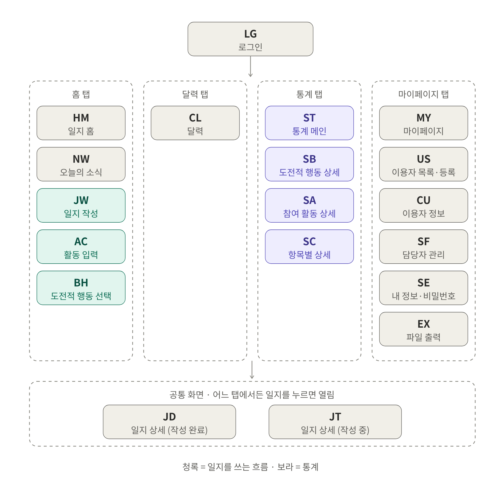
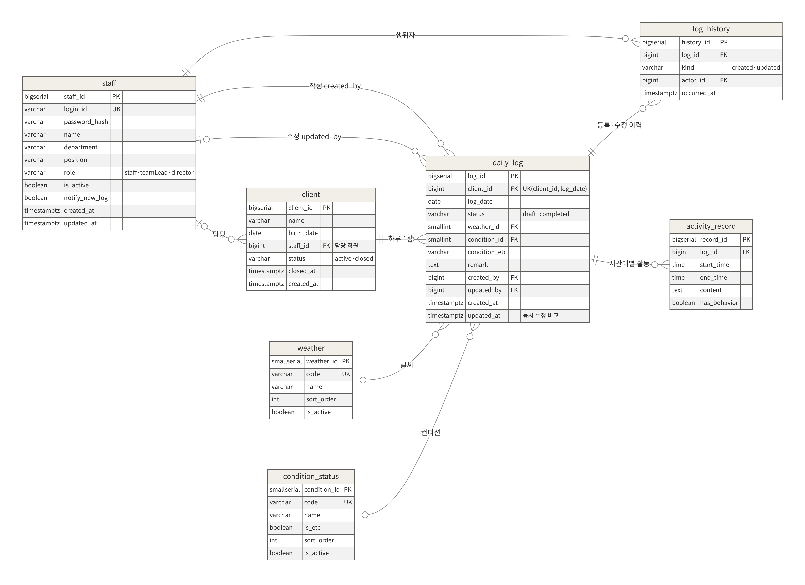
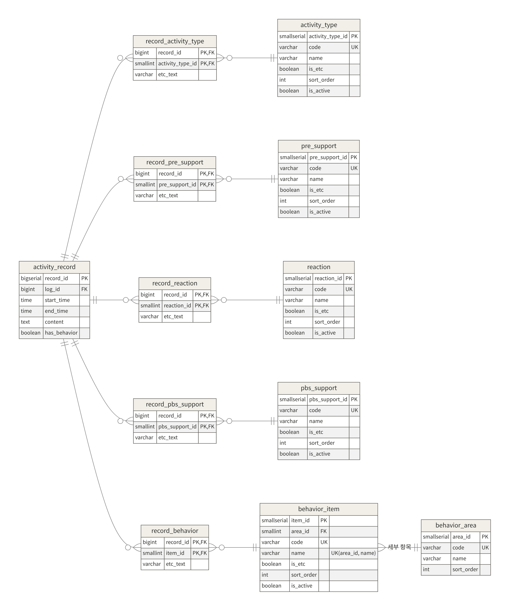

# 기능명세서 v0.3

원광장애인종합복지관 일지 관리 앱 · 프론트 구현 기준 · 리뷰 반영 · 2026. 10. 13.

> 기능 110개 — 구현 99 · 부분 구현 2 · 미구현 5 · 시연용 4

## 목차

1. [문서 개요](#1-문서-개요)
2. [화면 구성](#2-화면-구성)
3. [기능 상세 명세](#3-기능-상세-명세)
4. [API 명세](#4-api-명세)
5. [제안 API](#5-제안-api)
6. [프론트와 결정 사항이 다른 부분](#6-프론트와-결정-사항이-다른-부분)
7. [데이터 대응과 DB 반영 사항](#7-데이터-대응과-db-반영-사항)
8. [운영 정책](#8-운영-정책)
9. [협의 사항 현황](#9-협의-사항-현황)

## 1. 문서 개요

### 1.1. 목적

현재 프론트엔드(welfare-fe)에 실제로 구현된 화면과 동작을 기능 단위로 정리하고, 각 기능이 백엔드에 무엇을 요구하는지(서버 처리, API, 데이터)를 함께 적는다. 백엔드와 데이터베이스를 프론트에 맞춰 설계하기 위한 기준 문서다.

### 1.2. 기준 자료

- 프론트엔드 저장소 seoil-welfare/welfare-fe, main 브랜치 커밋 a87dfbb (2026. 10. 12.)
- 프론트 백엔드 연동 명세 초안 (docs/backend-integration.md) — 협의 사항 B-1~B-13
- 개발계획서 (FR-01~FR-92), 복지관 답변지 (2026. 9. 21.), 데이터베이스 스키마 초안 (schema.sql)

### 1.3. 버전별 변경

| 버전 | 변경 내용 |
| --- | --- |
| v0.1 | 개발계획서 기준으로 화면 14개, 기능 95개 정리 |
| v0.2 | 기준을 프론트 구현(welfare-fe)으로 변경. 기능마다 서버 처리·API 열 추가, 프론트에서 생긴 화면 6개와 신규 기능 추가 |
| v0.3 | 리뷰 반영. 공통 에러 코드 표(4.2), 일지 상태 전이 규칙(4.5), 동시 수정 규칙(4.6), 제안 API 장 신설(5장: 선택 항목 코드화, 통계 서버 집계, 직원 사용 중지), 운영 정책 장 신설(8장: 권한 기준안, 직원 사용 중지, 임시저장, 활동 시간), 관련 기능 행 수정(LG-01, JW-08~10, AC-02, JD-07, JT-06~07, MY-08~09, SF-01, SF-03 신규) |

기능 ID는 v0.1부터 같은 번호를 이어 쓴다. 번호 체계(FR 통일 / 약어 통일)는 팀에서 확정 후 맞춘다.

### 1.4. 표기

| 표기 | 의미 |
| --- | --- |
| 구현 | 프론트에 구현되어 mock 모드에서 동작함. 백엔드가 같은 규칙을 지키면 그대로 연결됨 |
| 부분 구현 | 화면은 있으나 일부 값이 임시이거나 동작이 덜 됨 |
| 미구현 | 회의나 기획서에서 정했지만 프론트에 아직 없음 |
| 시연용 | 회의 비교·시연을 위한 임시 동작. 운영 규칙이 아님 |
| (저장 시 함께) | 별도 API 없이 일지 저장(POST·PUT /diaries) 요청 안에 들어가는 값 |
| 기준안 | 근거 자료(복지관 답변, 양식)가 있어 개발은 이 방향으로 진행하되, 회의에서 최종 확인하는 안 |
| 제안 | 이 문서가 제시하는 방법. 프론트 수정이나 회의 합의가 있어야 적용 |
| 회의 확인 | 복지관 또는 팀이 결정해야 하는 사항. 명세서가 정하지 않음 |
| B-n, U-n | 프론트 연동 명세의 협의 항목 번호와 미확정 항목 번호 (9장) |

## 2. 화면 구성

### 2.1. 앱 전체 지도

### 2.2. 화면 목록과 구현 현황

| 화면 ID | 화면명 | 탭 | 프론트 경로 | 기능 수 | 구현 | 부분 구현 | 미구현 | 시연용 |
| --- | --- | --- | --- | --- | --- | --- | --- | --- |
| LG | 로그인 | - | /login | 4 | 2 | 1 | 1 | 0 |
| HM | 일지 홈 | 홈 | /home | 4 | 4 | 0 | 0 | 0 |
| NW | 오늘의 소식 | 홈 | /news | 3 | 3 | 0 | 0 | 0 |
| JW | 일지 작성 | 홈 | /diaries/new | 11 | 10 | 0 | 0 | 1 |
| AC | 활동 입력/수정 | 홈 | /diaries/new/activities/:id | 11 | 11 | 0 | 0 | 0 |
| BH | 도전적 행동 선택 | 홈 | …/activities/:id/behaviors/:type | 4 | 2 | 1 | 1 | 0 |
| CL | 달력 | 달력 | /calendar | 3 | 3 | 0 | 0 | 0 |
| ST | 통계 메인 | 통계 | /stats | 11 | 11 | 0 | 0 | 0 |
| SB | 도전적 행동 상세 통계 | 통계 | /stats/behaviors | 7 | 7 | 0 | 0 | 0 |
| SA | 참여 활동 상세 통계 | 통계 | /stats/activities | 6 | 6 | 0 | 0 | 0 |
| SC | 항목별 상세 통계 | 통계 | /stats/:category | 1 | 0 | 0 | 0 | 1 |
| JD | 일지 상세 (작성 완료) | 공통 | /diaries/:id | 10 | 9 | 0 | 1 | 0 |
| JT | 일지 상세 (작성 중) | 공통 | /diaries/:id | 8 | 7 | 0 | 0 | 1 |
| MY | 마이페이지 | 마이페이지 | /mypage | 10 | 9 | 0 | 0 | 1 |
| US | 이용자 목록·등록 | 마이페이지 | /users, /users/new | 2 | 2 | 0 | 0 | 0 |
| CU | 이용자 정보 | 마이페이지 | /users/:id | 8 | 8 | 0 | 0 | 0 |
| SF | 담당자 목록·계정 추가 | 마이페이지 | /staff, /staff/new | 3 | 2 | 0 | 1 | 0 |
| SE | 내 정보·비밀번호 변경 | 마이페이지 | /profile, /settings/password | 2 | 2 | 0 | 0 | 0 |
| EX | 파일 출력 | 마이페이지 | /exports/:kind | 2 | 1 | 0 | 1 | 0 |
| 합계 |  |  |  | 110 | 99 | 2 | 5 | 4 |

기능 수는 행 기준이다(MY-05~07처럼 묶은 행은 1개로 셈). 경로는 프론트 개발용 라우팅이며 공식 요구사항은 아니다.

## 3. 기능 상세 명세

### 3.1. 로그인 (LG)  —  /login

| 기능 | 화면 동작 (프론트) | 서버 처리 (백엔드) | API · 데이터 | 상태 |
| --- | --- | --- | --- | --- |
| **LG-01** 로그인 기획서 FR-01 | 아이디·비밀번호 입력. 빈칸 오류와 인증 실패 문구를 구분한다. 비밀번호 보기 토글. 성공하면 이전 사용자의 캐시를 지우고 홈으로 이동. | 아이디로 직원을 찾아 비밀번호 해시를 비교하고 세션(쿠키)을 만든다. 실패하면 401(INVALID_CREDENTIALS). 사용 중지 계정은 비밀번호가 맞아도 403(ACCOUNT_DISABLED). | POST /auth/login *staff* | 구현 (mock: 비밀번호 demo1234) |
| **LG-02** 자동 로그인 기획서 FR-02 | 체크 여부를 autoLogin 값으로 로그인 요청에 함께 보낸다. | autoLogin이 true면 세션 유지 기간을 길게 잡는다. | POST /auth/login *세션* | 부분 구현 값만 전송. 유지 기간 미정(B-9) |
| **LG-03** 비밀번호 재설정 기획서 FR-03 | 안내 창만 띄운다. 실제 절차 없음. | 미정. 제안: 관리자가 임시 비밀번호 발급, 첫 로그인 때 변경 강제. | - *staff* | 미구현 |
| **LG-04** 로그인 상태 확인 기획서 신규 | 앱을 시작할 때 내 정보를 요청한다. 401이면 로그인 화면, 네트워크·서버 오류면 "다시 시도"를 보여 준다(세션이 살아 있을 수 있으므로). | 세션의 직원 정보를 돌려준다. 세션이 없으면 401. | GET /auth/me *staff* | 구현 기획서에 없던 기능 |

### 3.2. 일지 홈 (HM)  —  /home

| 기능 | 화면 동작 (프론트) | 서버 처리 (백엔드) | API · 데이터 | 상태 |
| --- | --- | --- | --- | --- |
| **HM-01** 오늘 일지 작성 기획서 FR-04 | 일지 작성 화면으로 이동. 대상 이용자를 지정하지 않으면 그날 일지가 없는 첫 이용자를 기본으로 고른다. | - | GET /diaries (from=to=오늘) *daily_log* | 구현 |
| **HM-02** 날짜·사용자 표시 기획서 FR-05 | 오늘 날짜, 로그인한 직원 이름, "대상 이용자 N명 · 오늘 저장된 일지 N건"을 표시한다. | - | GET /auth/me GET /service-users GET /diaries *staff, client, daily_log* | 구현 |
| **HM-03** 오늘의 소식 3건 기획서 FR-06 | 오늘 발생한 등록·수정 이력을 최신순 3건까지 표시. 없으면 "오늘의 소식이 아직 없습니다". | 이력을 발생 시각 최신순으로 돌려준다. | GET /news (since=오늘) *log_history* | 구현 |
| **HM-04** 소식 상세 이동 기획서 FR-07 | 영역 전체를 누르면 소식 화면으로 이동. '더 보기'는 3건 이상일 때 보인다. | - | - *-* | 구현 확인: 3건이면 이미 다 보임 |

### 3.3. 오늘의 소식 (NW)  —  /news

| 기능 | 화면 동작 (프론트) | 서버 처리 (백엔드) | API · 데이터 | 상태 |
| --- | --- | --- | --- | --- |
| **NW-01** 활동 내역 조회 기획서 FR-08 | 오늘·어제 이력을 날짜별로 끊어 표시. '지난 소식 더 보기'를 누르면 3일씩 더 불러와 뒤에 붙인다. | since 날짜(포함) 이후 이력을 최신순으로, 일지 요약(id·이용자·날짜)과 함께 돌려준다. 작성 중 일지는 이력이 없다. | GET /news?since *log_history, daily_log* | 구현 3일 단위는 시연값(B-10) |
| **NW-02** 활동 필터 기획서 FR-09~11 | 전체·등록만·수정만과 각 건수를 표시. 추가로 불러온 목록에도 같은 필터를 적용한다. | - (프론트가 거른다) | - *log_history.kind* | 구현 |
| **NW-03** 일지 상세 이동 기획서 FR-12 | 해당 일지 상세로 이동한다. 수정 이력을 눌러도 최신 내용을 보여 준다. | - | GET /diaries/:id *daily_log* | 구현 |

### 3.4. 일지 작성 (JW)  —  /diaries/new

| 기능 | 화면 동작 (프론트) | 서버 처리 (백엔드) | API · 데이터 | 상태 |
| --- | --- | --- | --- | --- |
| **JW-01** 이용자·날짜 표시 기획서 FR-08* | 대상 이용자 선택 상자(이용 중인 이용자만)와 일지 날짜를 표시한다. | - | GET /service-users *client* | 구현 |
| **JW-02** 대상 이용자 변경 기획서 FR-09* | 입력 내용을 유지한 채 대상만 바꾼다. 같은 날 일지가 이미 있는 이용자를 고르면 "이대로 저장하면 기존 일지가 갱신돼요" 경고. | 이용자·날짜당 1건 규칙을 검사한다. 제안: 덮어쓰지 말고 409와 기존 일지 id를 돌려준다(B-1). | GET /diaries (from=to=작성일) *daily_log UNIQUE(client_id, log_date)* | 구현 협의 B-1, B-8 |
| **JW-03** 날씨 선택 기획서 FR-10* | 5개 중 1개, 기본값 맑음. | 목록에 있는 값인지 검사한다. | (저장 시 함께) *weather* | 구현 |
| **JW-04** 컨디션 선택 기획서 FR-11* | 5개 중 1개, 기본값 양호. '기타'면 입력란 표시. | '기타'일 때 입력 내용을 저장한다. | (저장 시 함께) *condition_status, condition_etc* | 구현 |
| **JW-05** 활동 요약 기획서 FR-12* | 시작 시각순으로 시간·요약을 보여 주고, 도전적 행동이 있으면 "도전적 행동 N건" 배지와 배경으로 강조. 누르면 활동 수정. | - | - *-* | 구현 |
| **JW-06** 활동 추가 기획서 FR-13 | "활동 N건"으로 표시(N/7 표기 제거). 개수 제한 없음. | 개수 제한이 정해지면 서버도 검사한다. | - *-* | 구현 |
| **JW-07** 특이사항 기획서 FR-14 | 자유 입력. | 그대로 저장한다. | (저장 시 함께) *daily_log.remark* | 구현 |
| **JW-08** 나중에 이어서 기획서 FR-15 | 상태 draft로 저장하고 성공하면 입력을 비운 뒤 일지 상세로 이동. 실패하면 입력 유지, 자동 재시도 안 함. 응답이 없으면 "저장 여부를 확인하지 못했어요" 안내. | 일지와 활동 전체를 한 트랜잭션으로 저장한다(기존 활동 삭제 후 새로 넣기). 소식 이력은 남기지 않는다. 수정(PUT)이면 updatedAt을 비교해 다르면 409(DIARY_UPDATED_BY_OTHER) (4.6). | POST /diaries PUT /diaries/:id *daily_log.status, activity_record, record_** | 구현 |
| **JW-09** 작성 완료 기획서 FR-16 | 상태 completed로 저장하고 일지 상세로 이동. | JW-08과 같이 저장. 처음 완료면 '등록', 완료 일지를 다시 저장하면 '수정' 이력과 수정자를 기록. 완료 → 작성 중 되돌리기는 400(INVALID_STATUS_TRANSITION)으로 거부(4.5). | POST /diaries PUT /diaries/:id *daily_log, log_history* | 구현 상태 전이 규칙은 서버에서 적용 |
| **JW-10** 상단 '임시저장' 기획서 신규 | 알림만 띄우고 서버에 저장하지 않는다. 화면도 그대로. 브라우저를 닫으면 입력이 사라진다. | 제안: status draft로 서버에 저장한다. 첫 저장 응답의 id를 작성 중 데이터에 넣고, 이후 저장은 PUT으로 보낸다(8.4). | (제안) POST → PUT *daily_log.status* | 시연용 서버 저장으로 변경 제안 |
| **JW-11** 중복 제출 막기 기획서 신규 | 저장 중에는 두 버튼을 모두 비활성화한다. | 멱등성 지원 여부(B-2). | - *-* | 구현 |

### 3.5. 활동 입력/수정 (AC)  —  /diaries/new/activities/:id

| 기능 | 화면 동작 (프론트) | 서버 처리 (백엔드) | API · 데이터 | 상태 |
| --- | --- | --- | --- | --- |
| **AC-01** 화면 제목 기획서 FR-17 | 신규는 '활동 입력', 수정은 '활동 수정'. | - | - *-* | 구현 |
| **AC-02** 활동 시간 기획서 FR-18 | 시·분 각각 선택. 시작 전에는 종료 비활성, 종료는 시작 이후만 표시, 거꾸로면 오류 문구. 현재 0~23시, 10분 단위. | HH:mm 형식과 종료가 시작보다 늦은지만 검사한다. 간격(30분) 검사는 하지 않는다(제안) — 화면 정책이 바뀌어도 서버를 고칠 필요가 없게. | (저장 시 함께) *activity_record. start_time, end_time* | 구현 기준안: 10~17시 30분 단위(8.5) |
| **AC-03** 참여 활동 기획서 FR-19 | 8개 복수 선택, '기타'면 입력란. | 목록 값인지 검사, 기타 내용 저장. | (저장 시 함께) *record_activity_ type* | 구현 |
| **AC-04** 활동 상세 내용 기획서 FR-20 | 자유 서술. | 그대로 저장한다. | (저장 시 함께) *activity_record. content* | 구현 |
| **AC-05** 사전 지원 기획서 FR-21 | 9개 복수 선택, '없음' 배타 동작(시연 설정에서 끌 수 있음). | '없음'과 다른 항목이 같이 오면 거부할지 결정. | (저장 시 함께) *record_pre_ support* | 구현 라벨 '선택지제공' 붙여 씀 |
| **AC-06** 이용자 반응 기획서 FR-22 | 5개 복수 선택, '기타'면 입력란. | 목록 값 검사. | (저장 시 함께) *record_reaction* | 구현 '도전적 행동' 항목 없음(양식에는 있음) |
| **AC-07** 긍정행동지원 기획서 FR-23 | 6개 복수 선택, '기타'면 입력란. | 목록 값 검사. | (저장 시 함께) *record_pbs_ support* | 구현 |
| **AC-08** 도전적 행동 기획서 FR-24 | '있음'을 켜면 4개 유형이 나타난다. 타해·자해·파괴행동은 세부 선택 화면으로 이동, 기타는 바로 입력. '있음'을 끄면 선택한 내용도 비운다. | hasBehavior가 false인데 행동이 함께 오면 거부(또는 무시)한다. | (저장 시 함께) *activity_record. has_behavior, record_behavior* | 구현 |
| **AC-09** 저장하고 다음 활동 기획서 FR-25 | 작성 중 임시 목록에만 반영하고 일지 작성 화면으로 돌아간다. 서버에는 저장하지 않으며, 새로고침하면 사라진다. | - | - *(앱 메모리)* | 구현 협의 B-5 |
| **AC-10** 이전 활동과 같게 기획서 신규 | 직전 활동의 참여 활동·사전 지원·반응·긍정행동지원 선택을 그대로 가져온다(시간·내용 제외). | - | - *-* | 구현 기획서에 없던 기능 |
| **AC-11** 취소 기획서 신규 | 입력을 버리고 일지 작성 화면으로 돌아간다. | - | - *-* | 구현 |

### 3.6. 도전적 행동 선택 (BH)  —  …/activities/:id/behaviors/:type

| 기능 | 화면 동작 (프론트) | 서버 처리 (백엔드) | API · 데이터 | 상태 |
| --- | --- | --- | --- | --- |
| **BH-01** 모두 해제 기획서 FR-26 | 모든 체크를 해제하고, 입력해 둔 '기타' 내용은 남긴다. | - | - *-* | 구현 |
| **BH-02** 세부 행동 선택 기획서 FR-27 | 복수 선택, '기타'면 입력란. 현재 목록은 "예시 항목 A~D" 임시 값. | 세부 항목 코드가 해당 유형에 속하는지 검사한다. | (저장 시 함께) *behavior_area, behavior_item* | 부분 구현 복지관 확정 목록 미반영 |
| **BH-03** 세부 행동 검색 기획서 신규 | 없음. | - | - *behavior_item* | 미구현 회의 결정 사항 |
| **BH-04** 선택 완료 기획서 FR-28 | "N개 선택 완료". 하나도 고르지 않으면 "선택 없이 완료"로 바뀌어 그대로 완료할 수 있다. | 0개 선택 허용 여부 결정(U3). | - *(앱 메모리)* | 구현 |

### 3.7. 달력 (CL)  —  /calendar

| 기능 | 화면 동작 (프론트) | 서버 처리 (백엔드) | API · 데이터 | 상태 |
| --- | --- | --- | --- | --- |
| **CL-01** 월 달력 기획서 미작성 | 화면에 보이는 6주(42일)만 불러온다. 날짜마다 "완료 수/대상 이용자 수"(예: 2/3)를 표시. 원형 게이지는 비교용 설정. | 기간 안의 일지 목록을 돌려준다. | GET /diaries (from, to) *daily_log* | 구현 지표 방식은 제안안 |
| **CL-02** 날짜별 이용자 목록 기획서 미작성 | 선택한 날의 이용자별 상태(등록·작성 중·미작성)와 작성자 이름. 일지가 있으면 상세로, 미작성이면 그 이용자·날짜로 새 일지 작성. | - | (CL-01 결과 사용) *daily_log, client, staff* | 구현 |
| **CL-03** 새 작성 제한 기획서 미작성 | 그날 모든 이용자에게 일지가 있으면 작성 버튼을 숨기고 이유를 표시한다. | B-1과 같은 규칙. | - *UNIQUE 제약* | 구현 |

### 3.8. 통계 메인 (ST)  —  /stats

| 기능 | 화면 동작 (프론트) | 서버 처리 (백엔드) | API · 데이터 | 상태 |
| --- | --- | --- | --- | --- |
| **ST-01** 이용자 선택 기획서 FR-29 | 선택한 이용자 기준으로 전체 통계를 다시 계산한다. 고른 이용자·기간·단위는 상세 화면까지 유지. | - | GET /service-users *client* | 구현 |
| **ST-02** 조회 기간 선택 기획서 FR-30 | 바텀시트 휠로 연·월·분기·주차를 고르고 '기간 적용' 버튼으로 적용한다. | - | - *-* | 구현 |
| **ST-03** 조회 단위 기획서 FR-31 | 주·월·분기·연간, 기본은 월. 주 탭을 유지. | - | - *-* | 구현 복지관도 주별 필요 |
| **ST-04** 도전적 행동 기록 건수 기획서 FR-32 | 선택된 세부 행동 개수를 합산(같은 활동의 같은 행동은 1건). | 현재: 작성 완료 일지 목록(GET /diaries)으로 프론트가 계산한다. 제안: 서버 집계 API(5.2)로 전환. | GET /diaries (userId, status= completed, from, to) *record_behavior* | 구현 |
| **ST-05** 발생 일수 기획서 FR-33 | 도전적 행동이 있는 날짜 수(중복 없이). | 현재: 작성 완료 일지 목록(GET /diaries)으로 프론트가 계산한다. 제안: 서버 집계 API(5.2)로 전환. | (ST-04와 같음) *daily_log* | 구현 |
| **ST-06** 이전 기간 대비 증감 기획서 FR-34 | 이전 기간이 0건이면 "–"와 "이전 기간 기록 없음". | 현재: 작성 완료 일지 목록(GET /diaries)으로 프론트가 계산한다. 제안: 서버 집계 API(5.2)로 전환. | (ST-04와 같음) *-* | 구현 |
| **ST-07** 추이 그래프 기획서 FR-35 | 막대그래프. 구간은 주 6주·월 6개월·분기 4분기·연 5년. | 현재: 작성 완료 일지 목록(GET /diaries)으로 프론트가 계산한다. 제안: 서버 집계 API(5.2)로 전환. 연 단위는 5년치를 한 번에 받아 느릴 수 있다. | (ST-04와 같음) *record_behavior* | 구현 성능 위험 |
| **ST-08** 유형별 도넛 기획서 FR-36 | 자해·타해·파괴행동·기타 건수와 비율. 색은 유형별로 고정. | 현재: 작성 완료 일지 목록(GET /diaries)으로 프론트가 계산한다. 제안: 서버 집계 API(5.2)로 전환. | (ST-04와 같음) *behavior_area* | 구현 |
| **ST-09** 도전적 행동 상세 이동 기획서 FR-37 | '자세히' → SB. | - | - *-* | 구현 |
| **ST-10** 항목별 통계 기획서 FR-38~42 | 참여 활동·반응·사전 지원·긍정행동지원(활동 기준)과 컨디션(일지 기준). 많은 순 가로 막대, 처음엔 상위 3개, '더 보기'로 전체. '기타' 입력은 '기타'로 합산. | 현재: 작성 완료 일지 목록(GET /diaries)으로 프론트가 계산한다. 제안: 서버 집계 API(5.2)로 전환. | (ST-04와 같음) *record_* 4종, daily_log* | 구현 |
| **ST-11** 항목별 상세 이동 기획서 FR-43 | 참여 활동은 SA, 나머지 4개는 SC로 이동. | - | - *-* | 구현 |

### 3.9. 도전적 행동 상세 통계 (SB)  —  /stats/behaviors

| 기능 | 화면 동작 (프론트) | 서버 처리 (백엔드) | API · 데이터 | 상태 |
| --- | --- | --- | --- | --- |
| **SB-01** 대상·기간 표시 기획서 FR-44 | 이용자명과 기간. 메인의 선택을 이어받는다. | - | - *client* | 구현 |
| **SB-02** 조회 단위 기획서 FR-45 | 메인 단위 유지, 바꾸면 다시 계산. | - | - *-* | 구현 |
| **SB-03** 요약 통계 기획서 FR-46 | 기록 건수·발생 일수·증감. 발생일 평균 없음. | 현재: 작성 완료 일지 목록(GET /diaries)으로 프론트가 계산한다. 제안: 서버 집계 API(5.2)로 전환. | (ST-04와 같음) *record_behavior* | 구현 |
| **SB-04** 유형별 필터 기획서 FR-47 | 전체·타해·자해·파괴행동·기타와 건수. 필터를 바꾸면 상단 요약도 바뀐다(설정에서 끌 수 있음). | - | - *behavior_area* | 구현 |
| **SB-05** 세부 행동별 건수 기획서 FR-48 | 많은 순 가로 막대. | 현재: 작성 완료 일지 목록(GET /diaries)으로 프론트가 계산한다. 제안: 서버 집계 API(5.2)로 전환. | (ST-04와 같음) *behavior_item* | 구현 |
| **SB-06** 발생 기록 목록 기획서 FR-49 | 날짜·시작 시각 최신순, 5건씩 더 보기. 날짜·시간·세부 행동 표시. | 현재: 작성 완료 일지 목록(GET /diaries)으로 프론트가 계산한다. 제안: 서버 집계 API(5.2)로 전환. 서버 집계 시 페이지 나눔 필요. | (ST-04와 같음) *activity_record, record_behavior* | 구현 |
| **SB-07** 발생 기록 상세 이동 기획서 FR-50 | 해당 일지 상세(JD)로 이동. | - | GET /diaries/:id *daily_log* | 구현 |

### 3.10. 참여 활동 상세 통계 (SA)  —  /stats/activities

| 기능 | 화면 동작 (프론트) | 서버 처리 (백엔드) | API · 데이터 | 상태 |
| --- | --- | --- | --- | --- |
| **SA-01** 대상·기간 표시 기획서 FR-51 | 메인의 선택 유지. | - | - *client* | 구현 |
| **SA-02** 조회 단위 기획서 FR-52 | 메인 단위 유지. | - | - *-* | 구현 |
| **SA-03** 요약 통계 기획서 FR-53 | 전체 건수, 활동 종류 수, '기타' 입력 건수. | 현재: 작성 완료 일지 목록(GET /diaries)으로 프론트가 계산한다. 제안: 서버 집계 API(5.2)로 전환. | (ST-04와 같음) *record_activity_ type* | 구현 |
| **SA-04** 활동별 참여 건수 기획서 FR-54 | 모든 종류를 많은 순 가로 막대로. 0건도 표시. | 현재: 작성 완료 일지 목록(GET /diaries)으로 프론트가 계산한다. 제안: 서버 집계 API(5.2)로 전환. | (ST-04와 같음) *record_activity_ type* | 구현 |
| **SA-05** 활동별 도전적 행동 기획서 FR-55 | 선택된 참여 활동 모두에 같은 건수를 넣는다(합계가 전체보다 클 수 있음을 화면에 표시). | 현재: 작성 완료 일지 목록(GET /diaries)으로 프론트가 계산한다. 제안: 서버 집계 API(5.2)로 전환. | (ST-04와 같음) *record_activity_ type, has_behavior* | 구현 배분 방식 협의 |
| **SA-06** 활동별 이용자 반응 기획서 FR-56 | 기준 참여 활동을 고르는 선택 상자를 추가했다. | 현재: 작성 완료 일지 목록(GET /diaries)으로 프론트가 계산한다. 제안: 서버 집계 API(5.2)로 전환. | (ST-04와 같음) *record_reaction* | 구현 선택 상자는 시연안 |

### 3.11. 항목별 상세 통계 (SC)  —  /stats/:category

| 기능 | 화면 동작 (프론트) | 서버 처리 (백엔드) | API · 데이터 | 상태 |
| --- | --- | --- | --- | --- |
| **SC-01** 항목별 상세 통계 기획서 FR-43 | 이용자 반응·사전 지원·긍정행동지원·컨디션 각각의 상세 화면. 항목별 건수를 많은 순으로 표시. | 현재: 작성 완료 일지 목록(GET /diaries)으로 프론트가 계산한다. 제안: 서버 집계 API(5.2)로 전환. | (ST-04와 같음) *record_* , daily_log* | 시연용 기획서에 화면 정의 없음 |

### 3.12. 일지 상세 (작성 완료) (JD)  —  /diaries/:id

| 기능 | 화면 동작 (프론트) | 서버 처리 (백엔드) | API · 데이터 | 상태 |
| --- | --- | --- | --- | --- |
| **JD-01** 기본 정보 기획서 FR-57 | 이용자명, 작성일, 작성자, 최종 수정자와 수정 시각, 상태 배지. | - | GET /diaries/:id *daily_log. created_by, updated_by* | 구현 |
| **JD-02** 요약 수치 기획서 FR-58 | 기록된 활동 수, 도전적 행동 건수, 날씨를 카드로 표시. | - | (같음) *record_behavior* | 구현 |
| **JD-03** 컨디션 기획서 FR-59 | 컨디션 표시. '기타'면 입력 내용, 비어 있으면 "입력된 내용이 없어요". | - | (같음) *daily_log* | 구현 |
| **JD-04** 활동 목록 기획서 FR-60 | "활동 N건"과 시간순 목록. | 활동을 시작 시각순으로 돌려준다. | (같음) *activity_record* | 구현 |
| **JD-05** 활동 펼치기 기획서 FR-61 | 아코디언으로 상세 내용·선택 항목·도전적 행동 표시. | - | - *record_** | 구현 |
| **JD-06** 도전적 행동 강조 기획서 FR-62 | 도전적 행동이 있는 활동을 색으로 구분. | - | - *has_behavior* | 구현 |
| **JD-07** 이 활동만 수정 기획서 FR-63 | 완료 일지에서만 보인다. 일지 전체를 작성 중 데이터로 불러온 뒤 활동 수정 화면으로 보낸다. 저장은 다시 일지 전체 저장. | PUT으로 일지 전체를 받는다. 상태는 completed로 유지하고 '수정' 이력과 수정자를 기록한다. updatedAt 비교(4.6). | GET /diaries/:id PUT /diaries/:id *daily_log, log_history* | 구현 수정 가능 기간 회의 확인 |
| **JD-08** 특이사항 기획서 FR-64 | 없으면 "기록된 특이사항이 없어요". | - | - *daily_log.remark* | 구현 |
| **JD-09** 일지 인쇄 기획서 신규 | 없음. | 양식대로 출력할 방법 결정 필요. | - *-* | 미구현 회의 결정 사항 |
| **JD-10** 없는 일지 기획서 신규 | "찾을 수 없는 일지예요"와 달력 이동 버튼. | 없는 id면 404. | GET /diaries/:id *-* | 구현 |

### 3.13. 일지 상세 (작성 중) (JT)  —  /diaries/:id

| 기능 | 화면 동작 (프론트) | 서버 처리 (백엔드) | API · 데이터 | 상태 |
| --- | --- | --- | --- | --- |
| **JT-01** 작성 중 기본 정보 기획서 FR-65 | '작성 중' 배지와 작성자·날짜. | - | GET /diaries/:id *daily_log* | 구현 |
| **JT-02** 날씨·컨디션 기획서 FR-66 | 임시 저장된 값 표시. | - | (같음) *daily_log* | 구현 |
| **JT-03** 활동 현황 기획서 FR-67 | 임시 저장된 활동을 시간순으로. | - | (같음) *activity_record* | 구현 |
| **JT-04** 남은 활동 안내 기획서 FR-68 | 미작성 영역 안내. | - | - *-* | 구현 개수 제한 미정 |
| **JT-05** 특이사항 기획서 FR-69 | 없으면 "아직 작성 전이에요". | - | - *daily_log.remark* | 구현 |
| **JT-06** 이어서 작성 기획서 FR-70 | 본인이 작성 중인 일지에만 버튼이 보인다. 기존 내용을 불러와 일지 작성 화면으로. | 권한 기준안(8.1) 확정 후 서버에서 같은 규칙으로 PUT을 허용·거부한다. | - *created_by* | 구현 회의 확인(8.1) |
| **JT-07** 다른 직원의 작성 중 일지 기획서 FR-71 | 하단 안내바("OO 님이 작성 중이에요"), 수정 버튼 없음. | 권한 기준안(8.1) 확정 후 서버도 같은 규칙 적용. 화면에서만 막으면 주소를 직접 입력해 우회할 수 있다. | - *created_by* | 구현 화면에서만 막음(8.1) |
| **JT-08** 공유 기획서 FR-72 | "공유 기능은 동작이 미확정입니다" 알림. | - | - *-* | 시연용 |

### 3.14. 마이페이지 (MY)  —  /mypage

| 기능 | 화면 동작 (프론트) | 서버 처리 (백엔드) | API · 데이터 | 상태 |
| --- | --- | --- | --- | --- |
| **MY-01** 사용자 정보 기획서 FR-73 | 이름, 부서, 직위, 팀장 배지. | - | GET /auth/me *staff* | 구현 |
| **MY-02** 내 정보 이동 기획서 FR-74 | SE-01로 이동. | - | - *-* | 구현 |
| **MY-03** 이용자 목록 이동 기획서 FR-75 | US-01로 이동. | - | - *-* | 구현 |
| **MY-04** 이용자 등록 이동 기획서 FR-76 | US-02로 이동. | - | - *-* | 구현 |
| **MY-05~07** 파일 출력 이동 기획서 FR-77~79 | 일지 모아 출력·월간 기록 출력·엑셀 내보내기 → EX. | - | - *-* | 구현 |
| **MY-08~09** 담당자 관리 이동 기획서 FR-80~81 | 팀장·국장에게만 메뉴가 보인다. 주소를 직접 치면 일반 직원도 들어갈 수 있다. | 권한 검사는 서버에서 한다(B-6). 누가 계정을 관리할지는 회의 확인(8.1). | - *staff.role* | 구현 권한은 시연 예시 |
| **MY-10** 새 일지 알림 기획서 FR-82 | 스위치. 기기 메모리에만 저장, 실제 알림 없음. | 서버 저장 여부 결정(B-13). | - *(staff.notify_ new_log 제안)* | 시연용 |
| **MY-11** 비밀번호 변경 이동 기획서 FR-83 | SE-02로 이동. | - | - *-* | 구현 |
| **MY-12** 로그아웃 기획서 FR-84 | 확인 창("저장하지 않은 내용은 사라져요"). 서버 요청이 실패해도 이 기기의 로그인 상태와 작성 중 일지를 지운다. | 세션을 지운다. | POST /auth/logout *세션* | 구현 |
| **MY-13** 앱 버전 기획서 FR-85 | 하단에 버전 표시. | - | - *-* | 구현 |

### 3.15. 이용자 목록·등록 (US)  —  /users, /users/new

| 기능 | 화면 동작 (프론트) | 서버 처리 (백엔드) | API · 데이터 | 상태 |
| --- | --- | --- | --- | --- |
| **US-01** 이용자 목록 기획서 FR-75 | 이용 중과 이용 종결을 나눠 표시하고, 담당 직원 이름(없으면 "미지정")을 함께 보여 준다. | 종결된 이용자도 포함해서 돌려준다(과거 일지에 이름을 표시해야 하므로). | GET /service-users *client* | 구현 |
| **US-02** 이용자 등록 기획서 FR-76 | 이름·생년월일·담당 직원 입력. 이름 빈칸, 생년월일 YYYY-MM-DD 형식 검사. | 같은 검사를 서버에서도 하고, 상태는 '이용 중'으로 만든다. | POST /service-users *client* | 구현 불일치: 복지관은 6자리 |

### 3.16. 이용자 정보 (CU)  —  /users/:id

| 기능 | 화면 동작 (프론트) | 서버 처리 (백엔드) | API · 데이터 | 상태 |
| --- | --- | --- | --- | --- |
| **CU-01** 이용자 정보 표시 기획서 FR-86 | 이름·생년월일·담당 직원. | - | GET /service-users *client* | 구현 |
| **CU-02** 이름 수정 기획서 FR-87 | 필수 입력. | 빈 이름 거부. | (저장 시 함께) *client.name* | 구현 |
| **CU-03** 생년월일 수정 기획서 FR-88 | YYYY-MM-DD 형식 검사. | 실제 있는 날짜인지 검사. | (저장 시 함께) *client.birth* | 구현 불일치: 복지관은 6자리 |
| **CU-04** 담당 직원 변경 기획서 FR-89 | 직원 선택 상자. | 존재하는 직원인지 검사. | (저장 시 함께) *client.staff_id* | 구현 |
| **CU-05** 저장 기획서 FR-90 | 저장을 눌렀을 때만 반영. | id는 바꾸지 않는다. | PUT /service-users/:id *client* | 구현 |
| **CU-06** 이용 종결 기획서 FR-91 | 확인 창("삭제가 아닙니다. 기존 일지와 통계는 그대로 남아요"). | 상태만 '종결'로 바꾼다. 과거 일지는 지우지 않는다. | POST /service-users/ :id/close *client.status* | 구현 재이용 기능 없음 |
| **CU-07** 수정 취소 기획서 FR-92 | 이전 화면으로. | - | - *-* | 구현 |
| **CU-08** 없는 이용자 기획서 신규 | "찾을 수 없는 이용자예요". | 없는 id면 404. | - *-* | 구현 |

### 3.17. 담당자 목록·계정 추가 (SF)  —  /staff, /staff/new

| 기능 | 화면 동작 (프론트) | 서버 처리 (백엔드) | API · 데이터 | 상태 |
| --- | --- | --- | --- | --- |
| **SF-01** 담당자 목록 기획서 FR-80 | 이름, 부서·아이디, 팀장 배지. | 사용 중지된 직원도 포함해 돌려준다(과거 일지의 작성자 이름 표시용). 응답에 isActive 추가(제안). 아이디(loginId)를 누구에게 보여 줄지 결정. | GET /staff *staff* | 구현 |
| **SF-02** 계정 추가 기획서 FR-81 | 이름·아이디·부서(기본 '주간활동지원팀')·역할 입력. 직위는 역할에서 정해진다. 비밀번호 입력란은 없다. 아이디 중복이면 입력란에 바로 오류. | 아이디 중복이면 409(DUPLICATE_LOGIN_ID). 초기 비밀번호 발급 방법 결정 필요. | POST /staff *staff* | 구현 초기 비밀번호 미정 |
| **SF-03** 계정 사용 중지 · 재개 기획서 신규 | 없음. 프론트 코드에 "계정 삭제·정지 정책은 U4 확인 전까지 추가하지 않는다" 주석이 있다. | 사용 중지하면 로그인 거부(403 ACCOUNT_DISABLED)하고 이미 로그인된 세션도 끊는다. 일지·작성자 기록은 지우지 않는다. 담당하던 이용자는 담당 미지정이 되므로 재배정 안내가 필요하다(8.3). | (제안) POST /staff/:id/ deactivate, /activate *staff.is_active* | 미구현 서버 규칙 먼저 확정 |

### 3.18. 내 정보·비밀번호 변경 (SE)  —  /profile, /settings/password

| 기능 | 화면 동작 (프론트) | 서버 처리 (백엔드) | API · 데이터 | 상태 |
| --- | --- | --- | --- | --- |
| **SE-01** 내 정보 기획서 FR-74 | 아이디, 소속 팀, 직책, 권한 표시. | - | GET /auth/me *staff* | 구현 |
| **SE-02** 비밀번호 변경 기획서 FR-83 | 현재·새 비밀번호·확인 입력. 빈칸과 새 비밀번호 불일치를 검사하고, 서버 오류 문구를 그대로 보여 준다. | 현재 비밀번호를 확인하고 규칙을 검사한 뒤 해시로 저장. 불일치·규칙 위반은 400과 안내 문구. | PUT /auth/password *staff* | 구현 mock은 실제로 안 바꿈 |

### 3.19. 파일 출력 (EX)  —  /exports/:kind

| 기능 | 화면 동작 (프론트) | 서버 처리 (백엔드) | API · 데이터 | 상태 |
| --- | --- | --- | --- | --- |
| **EX-01** 출력 대상·기간 선택 기획서 FR-77~79 | 이용자 전원을 기본 선택, 기간 선택. | - | GET /service-users *client* | 구현 |
| **EX-02** 출력 시작 기획서 FR-77~79 | 진행 표시 후 "출력 기능은 백엔드 연동 후 구현" 안내. 파일이 만들어진 것처럼 표시하지 않는다. | 형식·생성 방식 결정 후 구현(B-12, 동기 다운로드 / 비동기 작업). | (제안) POST /exports/... *daily_log 및 하위 테이블* | 미구현 |

## 4. API 명세

프론트 httpApi.ts에 구현된 호출 경로와 서버가 지켜야 할 규칙이다. 서버 규칙 중 '제안'으로 표시한 것은 프론트 수정이 함께 필요하다.

### 4.1. 공통 약속

| 항목 | 내용 |
| --- | --- |
| 기본 경로 · 형식 | /api 아래, JSON(UTF-8) |
| 날짜 · 시각 | 날짜는 YYYY-MM-DD(한국 시간 업무일), 시각은 오프셋이 붙은 ISO 8601(예: 2026-10-13T09:00:00+09:00), 활동 시간은 HH:mm |
| 오류 응답 | { "message": "...", "code": "...", "details": { ... } } — 코드 목록은 4.2 |
| 인증 | 쿠키 세션 전제. 모든 요청에 쿠키를 보냄(credentials: include). 어느 요청이든 401이면 로그인 화면으로 이동 |
| 식별자 | id는 서버가 발급하고 프론트는 문자열로 다룸. 활동 id는 프론트가 만든 임시 값(act-…)이며 서버가 새로 발급해도 됨 |
| 재시도 | 조회는 5xx·네트워크 오류 시 최대 2회 자동 재시도, 저장은 자동 재시도하지 않음 |
| 권한 검사 | 모든 권한 규칙은 서버에서 검사한다. 화면의 메뉴 숨김은 보안이 아니다 (NFR-06) |

### 4.2. 공통 에러 코드

| HTTP | code | 발생 상황 | 프론트 동작 | 구분 |
| --- | --- | --- | --- | --- |
| 400 | VALIDATION_ERROR | 필수값 누락, 형식 오류(날짜·시간·목록에 없는 값 등) | 안내 문구 표시. details.fields가 있으면 해당 입력란에 표시 | 제안 |
| 400 | INVALID_STATUS_TRANSITION | 작성 완료 일지를 작성 중으로 저장 (4.5) | 안내 문구 표시 | 제안 |
| 400 | CURRENT_PASSWORD_MISMATCH | 비밀번호 변경 시 현재 비밀번호가 틀림 | 입력란 오류 문구 | 제안 (400 처리는 구현됨) |
| 400 | PASSWORD_POLICY | 새 비밀번호가 규칙에 맞지 않음 | 입력란 오류 문구 | 제안 (400 처리는 구현됨) |
| 401 | UNAUTHENTICATED | 세션 없음 · 만료 | 로그인 상태를 비우고 로그인 화면으로 | 구현 |
| 401 | INVALID_CREDENTIALS | 로그인 아이디 · 비밀번호 불일치 | 로그인 화면 문구 | 구현 (mock) |
| 403 | ACCOUNT_DISABLED | 사용 중지된 계정으로 로그인 (8.3) | 로그인 화면 문구 | 제안 |
| 403 | FORBIDDEN | 권한이 없는 기능 요청 (8.1) | 조회: 문구 + 다시 시도 / 저장: 알림 | 구현 |
| 404 | NOT_FOUND | 일지 · 이용자 · 직원 없음 | 상세 화면은 "찾을 수 없음" 화면 | 구현 |
| 409 | DIARY_ALREADY_EXISTS | 같은 이용자 · 날짜 일지가 이미 있음. details.existingDiaryId 포함 (B-1) | 안내 후 기존 일지로 이동 (프론트 수정 필요) | 제안 |
| 409 | DIARY_UPDATED_BY_OTHER | 다른 사람이 먼저 수정함 — updatedAt 불일치 (4.6). details: updatedAt, lastEditorId(완료 후 수정만) | 확인 후 최신 내용 다시 불러오기 | 구현 |
| 409 | DUPLICATE_LOGIN_ID | 계정 추가 시 아이디 중복 | 아이디 입력란 오류 | 구현 |
| 500 | INTERNAL_ERROR | 서버 내부 오류 | 조회는 2회 자동 재시도 후 다시 시도, 저장은 재시도 안 함 | 구현 |

message는 화면에 그대로 표시되므로 사용자가 이해할 수 있는 한국어 문장으로 쓰고, SQL이나 예외 이름 같은 내부 정보를 넣지 않는다. details는 선택 항목이다.

### 4.3. 엔드포인트

| 메서드 · 경로 | 요청 | 응답 | 서버 규칙 | 관련 기능 |
| --- | --- | --- | --- | --- |
| POST /auth/login | { loginId, password, autoLogin } | Staff / 401 / 403 | 세션 생성. 실패 INVALID_CREDENTIALS, 사용 중지 계정 ACCOUNT_DISABLED | LG-01, LG-02 |
| POST /auth/logout | - | 204 | 세션 삭제 | MY-12 |
| GET /auth/me | - | Staff / 401 | 로그인 전이면 401 (프론트는 로그아웃 상태로 처리) | LG-04, MY-01, SE-01 |
| PUT /auth/password | { currentPassword, newPassword } | 204 / 400 | 현재 비밀번호 확인, 규칙 검사, 해시 저장 | SE-02 |
| GET /diaries | userId, from, to, status (모두 선택, from·to 포함) | Diary[] | 날짜 → 이용자 순 정렬 | HM, JW, CL, ST |
| GET /diaries/:id | - | Diary / 404 | 활동 포함 전체 | JD, JT, NW-03 |
| POST /diaries | SaveDiaryInput (diaryId 없음) | Diary / 400 / 409 | id 발급, 작성자 = 로그인 직원. completed면 'created' 이력. 같은 이용자·날짜가 있으면 409 DIARY_ALREADY_EXISTS (제안 — mock은 덮어씀) | JW-08~10 |
| PUT /diaries/:id | SaveDiaryInput + updatedAt | Diary / 400 / 404 / 409 | 작성자 유지, 활동은 통째로 교체. 상태 전이 규칙(4.5), 동시 수정 규칙(4.6) 적용 | JW-08~10, JD-07 |
| GET /news | since (포함) | NewsEntry[] | 발생 시각 최신순. 작성 중 저장은 이력 없음 | HM-03, NW |
| GET /service-users | - | ServiceUser[] | 종결된 이용자도 포함 | JW, US, CU, ST, EX |
| POST /service-users | { name, birthDate, assignedStaffId } | ServiceUser | 상태 active로 생성 | US-02 |
| PUT /service-users/:id | (같음) | ServiceUser / 404 | id 유지 | CU-05 |
| POST /service-users/:id/close | - | ServiceUser | status를 closed로. 삭제 아님 | CU-06 |
| GET /staff | - | Staff[] | 사용 중지 직원 포함, isActive 추가(제안) | SF-01 |
| POST /staff | { name, loginId, department, position, role } | Staff / 409 | 아이디 중복 DUPLICATE_LOGIN_ID | SF-02 |

통계·선택 항목·직원 사용 중지용 새 API는 5장에 제안으로 정리했다.

### 4.4. 일지 저장 데이터 (SaveDiaryInput)

| 필드 | 형식 | 설명 |
| --- | --- | --- |
| diaryId | 문자열, 선택 | 없으면 새 일지(POST), 있으면 수정(PUT) |
| updatedAt | ISO 8601 | PUT일 때 필수(없으면 400). 불러오거나 마지막으로 저장할 때 받은 값을 그대로 돌려보냄 (4.6) |
| userId · date | 문자열 · YYYY-MM-DD | 대상 이용자와 작성일 |
| status | draft \| completed | 작성 중 / 작성 완료 (4.5) |
| weather · condition · conditionOther | 현재 한글 라벨 | 예: "맑음", "기타" + 직접 입력. 코드 전환 후에는 코드 (5.1) |
| notes | 문자열 | 특이사항 |
| activities[] | 배열 | id, startTime, endTime, detail, hasBehavior, behaviors[], 그리고 아래 선택 항목 |
| participation[] · preSupport[] · reaction[] · positiveSupport[] | 현재 한글 라벨 배열 | 각각 *Other 필드에 '기타' 직접 입력. 코드 전환 후에는 코드 배열 (5.1) |
| behaviors[] | { type, detailIds[], otherText } | type: otherHarm \| selfHarm \| destruction \| other, detailIds: oh-1, sh-1 같은 코드 (이미 코드 방식) |

### 4.5. 일지 상태 전이 규칙

| 저장 전 상태 | 요청 status | 결과 | 소식 이력 · 기록 |
| --- | --- | --- | --- |
| 없음 (새 일지) | draft | 허용 | 이력 없음. 작성자 = 로그인 직원 |
| 없음 (새 일지) | completed | 허용 | '등록' 이력 |
| draft (작성 중) | draft | 허용 | 이력 없음 |
| draft (작성 중) | completed | 허용 | '등록' 이력 |
| completed (작성 완료) | completed | 허용 | '수정' 이력, 수정자·수정 시각 기록 |
| completed (작성 완료) | draft | 거부 | 400 INVALID_STATUS_TRANSITION. 저장하지 않음 |

작성 완료된 일지도 계속 수정할 수 있다. 상태는 completed로 유지되고 수정 이력이 남는다. 실수로 '작성 완료'를 누른 경우에도 이 방식으로 고친다. 되돌리기를 막는 이유는, 되돌리면 그 일지가 통계에서 갑자기 빠지고 소식에도 기록이 남지 않기 때문이다.

### 4.6. 동시 수정 규칙 (B-3)

1. 프론트는 일지를 불러올 때 받은 updatedAt을 작성 중 데이터에 보관하고, PUT 요청에 그대로 담아 보낸다.

2. 서버는 요청의 updatedAt과 DB의 updated_at을 비교한다. 같으면 저장하고 새 updatedAt을 돌려준다.

3. 다르면 저장하지 않고 409 DIARY_UPDATED_BY_OTHER를 돌려준다. details에 마지막 수정자와 수정 시각을 넣는다.

4. 프론트는 "다른 분이 먼저 수정했어요"라고 안내하고 최신 내용을 다시 불러온다. 입력하던 내용은 버리기 전에 확인을 받는다.

이용자가 10명 미만이라 충돌은 드물지만, 같은 일지를 휴대폰과 PC에서 동시에 열거나 두 직원이 같은 이용자의 일지를 고치면 생긴다. 이 규칙이 없으면 먼저 저장한 사람의 기록이 말없이 사라진다.

## 5. 제안 API

아래는 확정 API가 아니다. 모두 프론트 수정이 함께 필요하므로 프론트 담당자와 합의한 뒤 적용한다. 기존 API(4.3)는 전환이 끝날 때까지 그대로 둔다.

### 5.1. 선택 항목 코드화 (B-4)

현재 프론트는 선택 항목을 한글 라벨 그대로 저장한다. 라벨로 저장하면 이름을 바꾸거나 띄어쓰기가 다를 때 통계가 쪼개진다. 실제로 사전 지원은 '선택지제공', 긍정행동지원은 '선택지 제공'으로 이미 어긋나 있다(6장 5번). DB는 처음부터 번호·코드 방식으로 설계되어 있어 백엔드 쪽 준비는 되어 있다.

| GET /categories 응답 | 내용 |
| --- | --- |
| weather · condition · participation · preSupport · reaction · positiveSupport | [ { code, label, order, active } ] 배열 |
| behaviorTypes | [ { code, label, order } ] — otherHarm, selfHarm, destruction, other |
| behaviorDetails | { otherHarm: [ { code, label, order, active } ], selfHarm: [...], destruction: [...] } |
| 규칙 | 일지에는 code를 저장하고 화면은 label로 표시. 항목을 없앨 때는 삭제하지 않고 active: false로 숨긴다. 이름을 바꿔도 code가 같으면 과거 통계가 이어진다 |

**코드 규칙 (제안)**

| 분류 | 코드 = 라벨 |
| --- | --- |
| 날씨 | sunny = 맑음 · partly-cloudy = 구름조금 · cloudy = 흐림 · rain = 비 · snow = 눈 |
| 컨디션 | good = 양호 · normal = 보통 · low = 저조 · observe = 관찰요망 · other = 기타 |
| 참여 활동 | daily-living = 일상생활훈련 · art = 예술활동 · sports = 체육활동 · preferred = 선호활동 · community = 지역참여활동 · cooking = 요리활동 · field-trip = 현장학습 · other = 기타 |
| 사전 지원 | reinforcer = 강화물 · preparation = 활동준비 · guidance = 활동안내 · choice = 선택지 제공 · modeling = 모델링 · safety = 안전교육 · rest = 휴식 · none = 없음 · other = 기타 |
| 이용자 반응 | active = 적극적 참여 · stable = 안정적 참여 · partial = 부분적 참여 · not-joined = 참여하지 않음 · other = 기타  ('도전적 행동' 추가 여부는 회의 확인) |
| 긍정행동지원 | reinforcer = 강화물 · encouragement = 언어 촉진 및 격려 · choice = 선택지 제공 · rest = 휴식 · alternative = 대체행동 지원 · other = 기타 |
| 도전적 행동 세부 | 현재 프론트 형식을 유지: 타해 oh-1 ~ oh-9 + oh-other, 자해 sh-1 ~ sh-10 + sh-other, 파괴행동 ds-1 ~ ds-8 + ds-other (복지관 확정 목록 순서) |

전환 순서: ① 서버가 GET /categories 제공 → ② 프론트 catalog.ts를 조회 결과로 교체 → ③ 저장 값을 라벨에서 코드로 변경 → ④ 통계 정렬 기준(CATEGORY_ORDER)을 order로 변경. 지금은 개발 중이라 실제 데이터가 없으므로 기존 데이터 이전 작업은 필요 없다.

### 5.2. 통계 서버 집계 (B-11)

현재는 프론트가 작성 완료 일지를 모두 받아 직접 계산한다. 이용자 1명의 연간 통계를 보려면 5년치 일지(약 1,200건, 활동 포함)를 휴대폰으로 받아야 해서 모바일에서 느리다. 병목은 계산이 아니라 전송량이며, 서버가 집계하면 숫자 몇 개만 보내면 된다. PostgreSQL의 date_trunc(기간 묶기), GROUP BY(집계), LAG(직전 기간 비교) 같은 함수로 쿼리 한 번에 계산할 수 있어, DB 선정 이유와도 맞닿아 있다.

| 공통 파라미터 | 내용 |
| --- | --- |
| userId | 필수. 이용자 한 명 기준 (전체 합산 통계는 제공하지 않음) |
| unit | week \| month \| quarter \| year |
| year · month · quarter · week | unit에 맞는 값. week는 '해당 월의 N주차'(프론트 StatisticPeriod와 같음). 주차 계산과 월 경계 처리는 회의 확인 |

| 경로 | 응답 | 대응 화면 | 대체하는 계산 |
| --- | --- | --- | --- |
| GET /stats/summary | { period, completedDiaries, behavior: { count, days, delta, previousEmpty, byType, typeSummary, trend[], details[], records[] }, participation[], reaction[], preSupport[], positiveSupport[], condition[], activities: { totalCount, kindCount, otherCount, behaviorByParticipation[], reactionByParticipation[] } } | ST, SB, SA, SC | ST-04~ST-10, SB-03~SB-06, SA-03~SA-06, SC-01 |

**구현됨.** 통계 화면 4개가 이 응답 하나를 함께 쓴다(상세 화면으로 옮겨도 다시 부르지 않는다). 처음 제안한 /stats/behaviors · /stats/activities · /stats/categories는 따로 만들지 않았다. 유형 필터·기준 참여 활동은 프론트가 이 응답에서 고른다.

- 목록 항목(CountItem)은 { code, label, count }. 많은 순, 같으면 목록 순서이며 0건 항목도 넣는다. 통계 메인은 0건을 빼고 보여 준다.
- details는 세부 행동 { type, detailId, count } (1건 이상만). records는 도전적 행동이 있었던 활동 1개 = 1줄, 날짜·시작 시각 최신순.
- 규칙은 프론트 statsService.ts의 statsSummary와 같다. 같은 DB 일지로 둘을 비교해 이용자 4명 × 기간 8개가 모두 같은 값임을 확인했다.

**집계 규칙 (개발계획서 「통계 집계 공통 규칙」을 서버에서 그대로 적용)**

- 작성 완료(completed) 일지만 집계. 작성 중 일지는 제외. 기간 경계는 한국 시간 기준
- 도전적 행동은 세부 항목 선택 건수. 같은 활동의 같은 행동은 1건, 최상위 '기타'는 내용이 있으면 1건. 발생 일수는 날짜 중복 없이
- 참여 활동·반응·사전 지원·긍정행동지원은 활동 기준, 컨디션은 일지 기준. '기타' 자유 입력은 '기타'로 합산
- 정렬은 건수 많은 순, 같으면 정해진 항목 순서(order). 이전 기간이 0건이면 previousEmpty: true

전환 방식: GET /diaries는 그대로 두고 /stats API를 추가한다. 화면 4개(ST, SB, SA, SC)를 하나씩 옮기고, 같은 기간에 대해 프론트 계산과 서버 결과가 같은지 비교해 검증한 뒤 프론트 계산을 걷어 낸다.

### 5.3. 직원 사용 중지 (SF-03)

| 메서드 · 경로 | 응답 | 서버 규칙 |
| --- | --- | --- |
| POST /staff/:id/deactivate | Staff (isActive: false) | is_active = false. 해당 직원의 세션을 모두 끊는다. 일지·작성자 기록은 그대로 |
| POST /staff/:id/activate | Staff (isActive: true) | 다시 로그인할 수 있게 한다 |

## 6. 프론트와 결정 사항이 다른 부분

프론트는 복지관 답변지(9. 21.)가 반영되기 전 기준으로 만들어졌다. 아래 항목은 프론트 수정 또는 회의 확정이 필요하다.

| No | 항목 | 현재 프론트 | 결정 사항 · 양식 | 제안 |
| --- | --- | --- | --- | --- |
| 1 | 도전적 행동 세부 목록 | "예시 항목 A~D" 임시 값 | 복지관 답변 2: 타해 10·자해 11·파괴행동 9개(기타 포함), '타인' 표현 제거 | catalog.ts를 확정 목록으로 교체 (schema.sql에 목록 있음) |
| 2 | 생년월일 형식 | YYYY-MM-DD 입력·저장 | 복지관 답변 4: 6자리 | 화면 입력은 6자리, DB는 날짜 타입 저장 (6자리만 저장하면 1900년대·2000년대 구분 불가) |
| 3 | 활동 시간 | 0~23시, 10분 단위 | 복지관 양식: 10~17시, 30분 단위 | 기준안으로 양식을 따른다 (8.5) |
| 4 | 이용자 반응 '도전적 행동' | 항목 없음 | 복지관 양식에는 있음 (개발계획서에는 없음) | 복지관에 넣을지 확인 |
| 5 | '선택지 제공' 띄어쓰기 | 사전 지원은 '선택지제공', 긍정행동지원은 '선택지 제공' | 양식: 둘 다 '선택지 제공' | 코드화로 근본 해결 (5.1) |
| 6 | 세부 행동 검색 · 일지 단건 인쇄 | 없음 | 회의에서 넣기로 결정 | BH-03, JD-09로 추가 구현 |
| 7 | 권한 구분 | 팀장·국장에게만 담당자 관리 메뉴, 작성 중 일지는 본인만 이어서 작성 | 복지관 답변 7: 담당자·관리자 동일 권한, 전원 조회·작성 가능 | 기준안과 회의 확인 항목 정리 (8.1) |
| 8 | 상단 임시저장 | 서버에 저장하지 않음 | - | 서버 저장으로 통일 (8.4) |

## 7. 데이터 대응과 DB 반영 사항

테이블 구조는 [schema_v0.3.sql](schema_v0.3.sql), 관계도는 아래 ERD를 참고한다.

| 프론트 타입 (types/index.ts) | DB 테이블 | 반영 필요 |
| --- | --- | --- |
| Staff | staff | department(부서), role(staff · teamLead · director) 칸 추가. 응답에 isActive 추가 (is_active 칸은 이미 있음) |
| ServiceUser | client | staff_id(담당 직원) 추가, status(active · closed)는 is_active로 대응, 생년월일 CHAR(6) → DATE |
| Diary | daily_log | status(draft · completed) 추가. 동시 수정 비교에 updated_at 사용 (이미 있음) |
| Activity | activity_record | 맞음 (start_time, end_time, content, has_behavior) |
| Activity.participation 등 4종 + *Other | record_* 4개 + etc_text | 맞음. '기타' 행의 etc_text에 직접 입력 저장 |
| 선택 항목 목록 | weather 등 목록 테이블 7개 | 각 테이블에 code 칸 추가 (5.1) |
| BehaviorSelection | record_behavior + behavior_item | 맞음. behavior_item에 code 칸 추가 (oh-1 등) |
| DiaryEvent | 없음 | log_history 테이블 추가 (일지, 구분 created · updated, 행위자, 발생 시각) |

## 8. 운영 정책

명세서가 정할 수 없는 정책은 '기준안'(근거 자료가 있어 개발은 이 방향으로 진행)과 '회의 확인'(복지관·팀이 결정)으로 나눠 적는다.

### 8.1. 권한

| 구분 | 기준안 | 근거 | 회의 확인 |
| --- | --- | --- | --- |
| 일지 조회 | 모든 직원이 모든 이용자의 일지를 조회 | 복지관 답변 7 | - |
| 작성 완료 일지 작성 · 수정 | 모든 직원 가능 | 복지관 답변 7 | 수정 가능 기간을 둘지 |
| 다른 직원의 작성 중 일지 이어 쓰기 | 미정 (현재 프론트: 본인만) | 답변 7은 작성 중 일지를 따로 언급하지 않음 | 확인 필요. 8.3(퇴사 직원의 작성 중 일지)과 함께 결정 |
| 이용자 등록 · 수정 · 종결 | 모든 직원 가능 | 답변 7 '별도 권한 구분 불필요' | 확인 필요 |
| 계정 추가 · 사용 중지 | 미정 (현재 프론트: 팀장·국장 메뉴) | 답변 7은 기록 권한만 언급 | 확인 필요. 정해진 규칙은 서버에서 검사 |

### 8.2. 일지 상태

작성 중 → 작성 완료는 한 방향으로만 바뀐다. 작성 완료 일지는 완료 상태 그대로 수정한다. 자세한 규칙은 4.5.

### 8.3. 직원 사용 중지

- 퇴사·직무 정지 직원은 삭제하지 않고 사용 중지한다. 로그인은 거부(403 ACCOUNT_DISABLED)하고, 이미 로그인된 세션도 끊는다.
- 직원 목록(GET /staff)에는 계속 포함한다. 과거 일지에 작성자 이름을 보여 줘야 하기 때문이다 (이용자 종결과 같은 원리).
- 담당하던 이용자는 '담당 미지정'이 되므로, 다른 직원 배정이 필요하다는 안내를 보여 준다.
- 그 직원이 작성 중이던 일지: '본인만 이어 쓰기' 규칙이 유지되면 아무도 완료할 수 없게 된다. 8.1의 이어 쓰기 권한을 정할 때 이 경우를 함께 정해야 한다 (회의 확인).

### 8.4. 임시저장

- 상단 '임시저장'도 status draft로 서버에 저장한다 (제안). 지금처럼 화면에만 알림을 띄우면 브라우저를 닫을 때 입력이 사라진다.
- 새 일지의 첫 저장은 POST, 응답으로 받은 id를 작성 중 데이터에 넣고 그다음 저장부터는 PUT으로 보낸다. 이렇게 하지 않으면 두 번째 임시저장이 다시 POST가 되어 409(DIARY_ALREADY_EXISTS)가 난다.
- 이렇게 바꾸면 상단 '임시저장'과 하단 '나중에 이어서'의 차이는 화면에 머무르는지 나가는지뿐이다. 버튼을 둘 다 둘지는 U1 안건으로 함께 결정한다 (회의 확인).
- 개인정보가 담긴 기록이므로 브라우저 저장소(localStorage)에 보관하는 방식은 쓰지 않는다.

### 8.5. 활동 시간

- 기준안: 복지관 양식대로 10시~17시, 30분 단위. 프론트 선택 목록(현재 0~23시, 10분)을 여기에 맞춘다.
- 서버는 HH:mm 형식과 종료가 시작보다 늦은지만 검사하고, 30분 간격은 검사하지 않는다 (제안). DB는 TIME 칸이라 간격과 무관하다.

## 9. 협의 사항 현황

프론트 연동 명세 6장의 협의 항목과 이 문서에서 정리한 위치다.

| ID | 항목 | 현재 프론트 | 정리 내용 |
| --- | --- | --- | --- |
| B-1 | 이용자 1명당 하루 1건 | mock은 같은 이용자·날짜를 덮어씀 | DB UNIQUE 제약으로 막고, 409 DIARY_ALREADY_EXISTS + 기존 일지 id (4.2, 4.3) |
| B-2 | 저장 중복 방지 | 자동 재시도 없음 | B-1이 409면 새 일지 중복은 DB가 막음. PUT은 같은 내용을 다시 보내도 결과가 같음. 별도 멱등 키 불필요 |
| B-3 | 동시 수정 | 저장마다 updatedAt을 보냄 | updatedAt 비교 + 409 DIARY_UPDATED_BY_OTHER (4.6, 구현) |
| B-4 | 선택 항목 값 형식 | 한글 라벨 저장 | 코드 저장 + GET /categories (5.1, 제안) |
| B-5 | 작성 중 일지 보존 | 상단 임시저장은 서버 저장 안 함 | 서버 draft 저장으로 통일, 첫 저장 후 PUT (8.4, 제안) |
| B-6 | 화면 접근 제한 | 메뉴만 숨김 | 모든 권한은 서버 검사 (4.1), 권한 기준안 (8.1) |
| B-7 | 다른 직원의 작성 중 일지 | 읽기만 가능하게 표시 | 회의 확인 (8.1, 8.3) |
| B-8 | 저장된 일지의 이용자 변경 | 바꾸면 userId가 바뀜 | 저장된 일지는 이용자 변경을 막는 쪽 제안 (UNIQUE 충돌, 다른 이용자 기록 섞임 위험) |
| B-9 | 자동 로그인 | 값만 전송 | 세션 유지 기간과 공용 기기 정책 회의 확인 |
| B-10 | 소식 조회 단위 | 날짜 범위 3일씩 | 이용자 10명 미만 규모라 현재 방식 유지 가능 |
| B-11 | 통계 집계 위치 | 프론트 계산 | 서버 집계 API로 단계적 전환 (5.2, 제안) |
| B-12 | 파일 출력 | 미연동 | 엑셀부터. PDF·HWPX는 양식 확정 후 |
| B-13 | 알림 설정 | 기기 메모리만 | 서버 저장 시 staff에 알림 설정 칸 추가 |
| 신규 | 완료 → 작성 중 되돌리기 | mock은 막지 않음 | 서버에서 거부 (4.5) |
| 신규 | 직원 사용 중지 | 없음 (U4 대기) | 서버 규칙 먼저 확정 (5.3, 8.3) |
